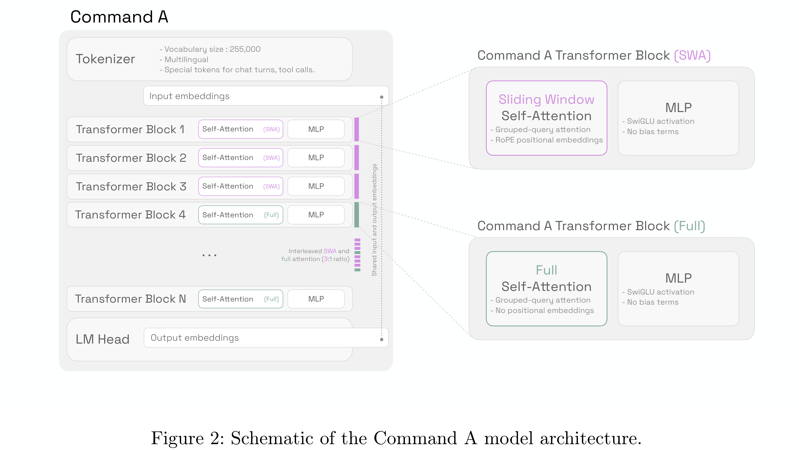

# Command A: An Enterprise-Ready Large Language Model

[Official source](https://cohere.com/research/papers/command-a-technical-report.pdf)

## Abstract

In this report we describe the development of Command A, a powerful large language model purpose-built to excel at real-world enterprise use cases. Command A is an agent-optimised and multilingual-capable model, with support for 23 languages of global business, and a novel hybrid architecture balancing efficiency with top of the range performance. It offers best-in-class Retrieval Augmented Generation (RAG) capabilities with grounding and tool use to automate sophisticated business processes. These abilities are achieved through a decentralised training approach, including self-refinement algorithms and model merging techniques. We also include results for Command R7B which shares capability and architectural similarities to Command A. Weights for both models have been released for research purposes. This technical report details our original training pipeline and presents an extensive evaluation of our models across a suite of enterprise-relevant tasks and public benchmarks, demonstrating excellent performance and efficiency.

Figure 2: Schematic of the Command A model architecture.

p. 3
