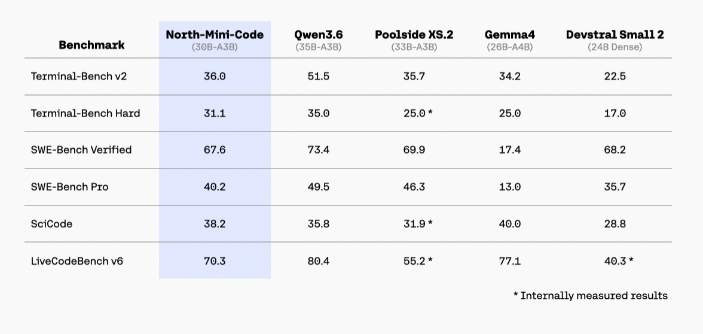

# North Mini Code 1.0

[Official source](https://huggingface.co/CohereLabs/North-Mini-Code-1.0)

## Model Summary

North Mini Code is an open weights research release of a 30B-A3B parameter model optimized for code generation, agentic software engineering, and terminal tasks.

