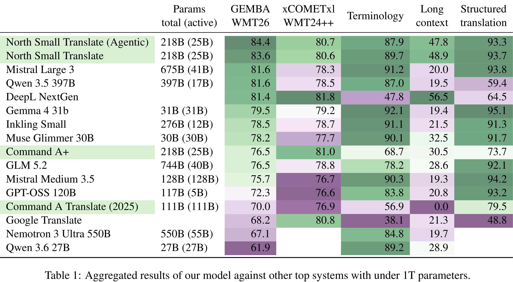
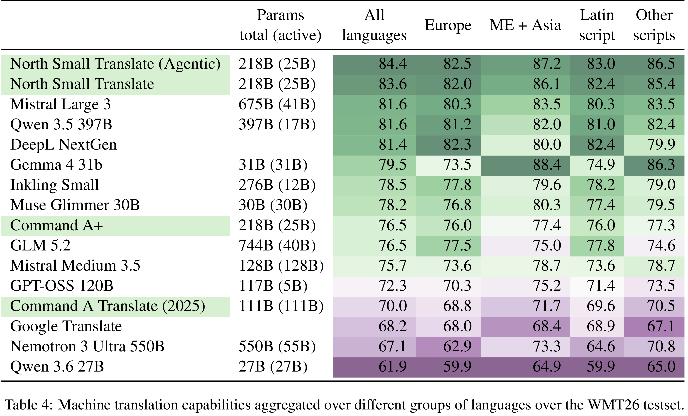

# North Small Translate: Advanced Cost-Effective Translation (Cohere CAT+)

[Official source](https://arxiv.org/abs/2609.13916)

## Abstract

We present North Small Translate, an openweight, LLM-based machine translation (MT) model with instruction-following capabilities built on the same foundation as Cohere’s Command A+, a mixture-of-experts architecture with 25 billion active parameters out of 218 billion total parameters. North Small Translate is trained using difficulty sampling to obtain challenging documents and a five-step training protocol combining supervised fine-tuning, direct preference optimization, and online reinforcement learning. We prioritized throughput through a non-reasoning base model and supplemented with optional agentic capabilities to unlock translation quality gains. North Small Translate is trained to perform MT-related tasks, including post-editing and quality estimation, as well as related tasks such as general instruction following. The model achieves top MT performance across 50 languages in the class of models under 1T parameters, with no need to run expensive reasoning at inference time.

## 2.1 Model Architecture

Our model is built on top of Command A+ (Cohere Team, 2026), a decoder-only sparse Mixture-of-Experts transformer (Vaswani et al., 2017) with 218B total parameters and 25B active.3

p. 2

Table 1: Aggregated results of our model against other top systems with under 1T parameters.

p. 2

Table 4: Machine translation capabilities aggregated over different groups of languages over the WMT26 testset.

p. 8
