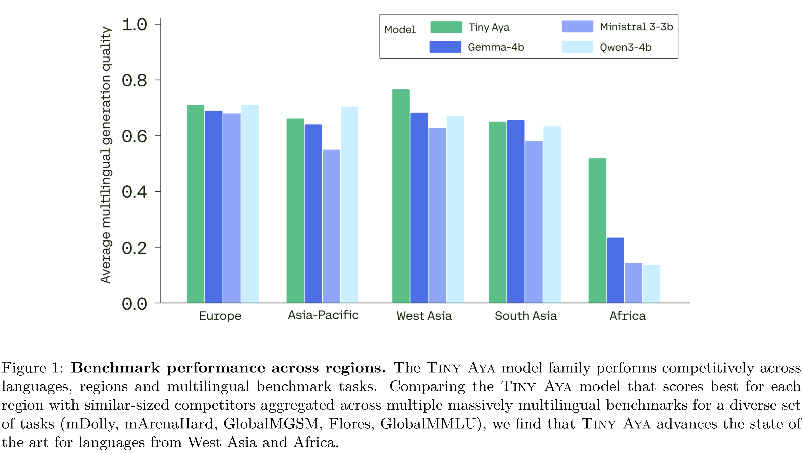

# Tiny Aya: Bridging Scale and Multilingual Depth

[Official source](https://cohere.com/research/aya)

## Abstract

Tiny Aya redefines what a small multilingual language model can achieve. Trained on 70 languages and refined through region-aware posttraining, it delivers state-of-the-art in translation quality, strong multilingual understanding, and high-quality target-language generation, all with just 3.35B parameters. The release includes a pretrained foundation model, a globally balanced instruction-tuned variant, and three region-specialized models targeting languages from Africa, South Asia, Europe, Asia-Pacific, and West Asia. This report details the training strategy, data composition, and comprehensive evaluation framework behind Tiny Aya, and presents an alternative scaling path for multilingual AI: one centered on efficiency, balanced performance across languages, and practical deployment.

Figure 1: Benchmark performance across regions. The Tiny Aya model family performs competitively across languages, regions and multilingual benchmark tasks. Comparing the Tiny Aya model that scores best for each region with similar-sized competitors aggregated across multiple massively multilingual benchmarks for a diverse set of tasks (mDolly, mArenaHard, GlobalMGSM, Flores, GlobalMMLU), we find that Tiny Aya advances the state of the art for languages from West Asia and Africa.

p. 2
