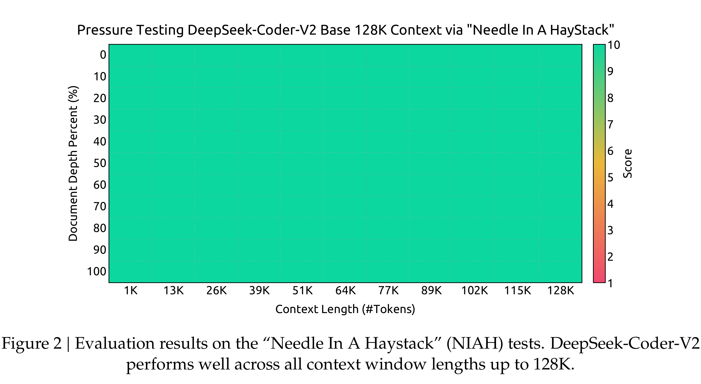

# DeepSeek-Coder-V2: Breaking the Barrier of Closed-Source Models in Code Intelligence

[Official source](https://github.com/deepseek-ai/DeepSeek-Coder-V2)

## Abstract

We present DeepSeek-Coder-V2, an open-source Mixture-of-Experts (MoE) code language model that achieves performance comparable to GPT4-Turbo in code-specific tasks. Specifically, DeepSeek-Coder-V2 is further pre-trained from an intermediate checkpoint of DeepSeek-V2 with additional 6 trillion tokens. Through this continued pre-training, DeepSeek-Coder-V2 substantially enhances the coding and mathematical reasoning capabilities of DeepSeek-V2, while maintaining comparable performance in general language tasks. Compared to DeepSeek-Coder-33B, DeepSeek-Coder-V2 demonstrates significant advancements in various aspects of code-related tasks, as well as reasoning and general capabilities. Additionally, DeepSeek-Coder-V2 expands its support for programming languages from 86 to 338, while extending the context length from 16K to 128K. In standard benchmark evaluations, DeepSeek-Coder-V2 achieves superior performance compared to closed-source models such as GPT4-Turbo, Claude 3 Opus, and Gemini 1.5 Pro in coding and math benchmarks.

Figure 2 | Evaluation results on the “Needle In A Haystack” (NIAH) tests. DeepSeek-Coder-V2 performs well across all context window lengths up to 128K.

p. 6
