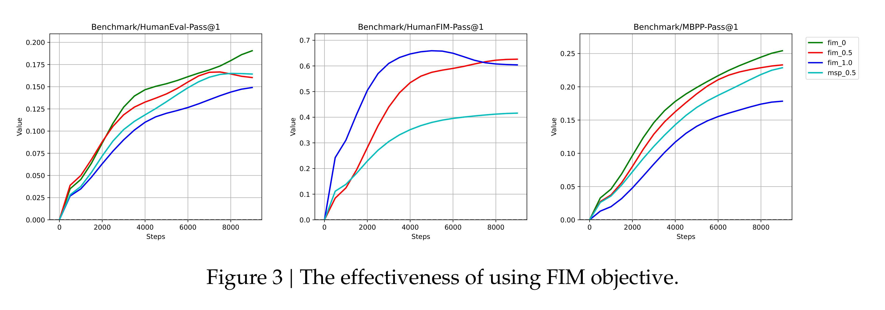

# DeepSeek-Coder: When the Large Language Model Meets Programming -- The Rise of Code Intelligence

[Official source](https://github.com/deepseek-ai/DeepSeek-Coder)

## Abstract

The rapid development of large language models has revolutionized code intelligence in software development. However, the predominance of closed-source models has restricted extensive research and development. To address this, we introduce the DeepSeek-Coder series, a range of open-source code models with sizes from 1.3B to 33B, trained from scratch on 2 trillion tokens. These models are pre-trained on a high-quality project-level code corpus and employ a fill-in-the-blank task with a 16K window to enhance code generation and infilling. Our extensive evaluations demonstrate that DeepSeek-Coder not only achieves state-of-the-art performance among open-source code models across multiple benchmarks but also surpasses existing closed-source models like Codex and GPT-3.5. Furthermore, DeepSeek-Coder models are under a permissive license that allows for both research and unrestricted commercial use.

Figure 3 | The effectiveness of using FIM objective.

p. 7
