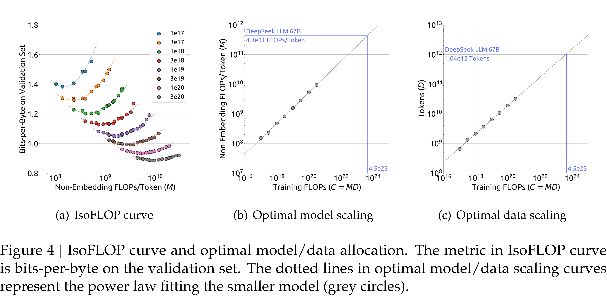

# DeepSeek LLM: Scaling Open-Source Language Models with Longtermism

[Official source](https://github.com/deepseek-ai/DeepSeek-LLM)

## Abstract

The rapid development of open-source large language models (LLMs) has been truly remarkable. However, the scaling laws described in previous literature presents varying conclusions, which casts a dark cloud over scaling LLMs. We delve into the study of scaling laws and present our distinctive findings that facilitate the scaling of large scale models in two prevalent used open-source configurations, 7B and 67B. Guided by the scaling laws, we introduce DeepSeek LLM, a project dedicated to advancing open-source language models with a long-term perspective. To support the pre-training phase, we have developed a dataset that currently consists of 2 trillion tokens and is continuously expanding. We further conduct supervised fine-tuning (SFT) and direct preference optimization (DPO) on DeepSeek LLM Base models, resulting in the creation of DeepSeek Chat models. Our evaluation results demonstrate that DeepSeek LLM 67B surpasses LLaMA-2 70B across a range of benchmarks, especially in the domains of code, mathematics, and reasoning. Furthermore, open-ended evaluations reveal that our DeepSeek LLM 67B Chat exhibits superior performance compared to GPT-3.5.

*Authors are ordered alphabetically by the last name.

Figure 4 | IsoFLOP curve and optimal model/data allocation. The metric in IsoFLOP curve is bits-per-byte on the validation set. The dotted lines in optimal model/data scaling curves represent the power law fitting the smaller model (grey circles).

p. 11
