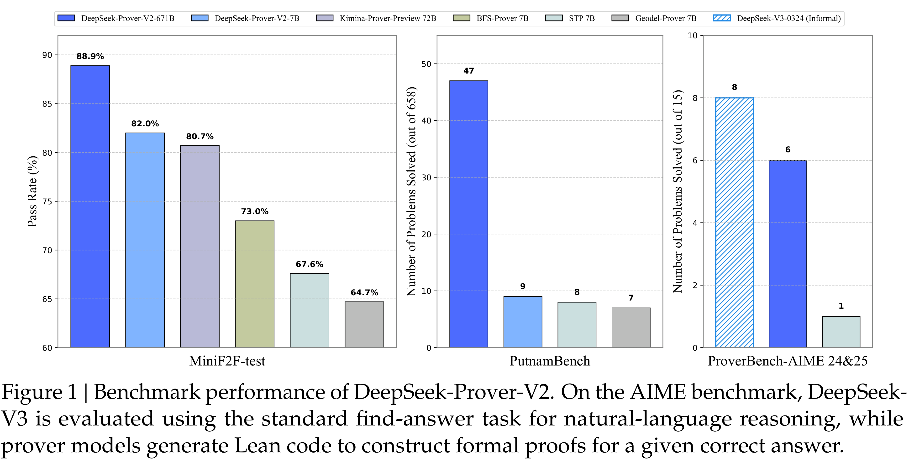

# DeepSeek-Prover-V2 Technical Report

[Official source](https://github.com/deepseek-ai/DeepSeek-Prover-V2)

## Abstract

We introduce DeepSeek-Prover-V2, an open-source large language model designed for formal theorem proving in Lean 4, with initialization data collected through a recursive theorem proving pipeline powered by DeepSeek-V3. The cold-start training procedure begins by prompting DeepSeek-V3 to decompose complex problems into a series of subgoals. The proofs of resolved subgoals are synthesized into a chain-of-thought process, combined with DeepSeek-V3’s step-by-step reasoning, to create an initial cold start for reinforcement learning. This process enables us to integrate both informal and formal mathematical reasoning into a unified model. The resulting model, DeepSeek-Prover-V2-671B, achieves state-of-the-art performance in neural theorem proving, reaching 88.9% pass ratio on the MiniF2F-test and solving 47 out of 658 problems from PutnamBench. In addition to standard benchmarks, we introduce ProverBench, a collection of 325 formalized problems, to enrich our evaluation, including 15 selected problems from the recent AIME competitions (years 24-25). Further evaluation on these 15 AIME problems shows that the model successfully solves 6 of them. In comparison, DeepSeek-V3 solves 8 of these problems using majority voting, highlighting that the gap between formal and informal mathematical reasoning in large language models is substantially narrowing.

Figure 1 | Benchmark performance of DeepSeek-Prover-V2. On the AIME benchmark, DeepSeek-V3 is evaluated using the standard find-answer task for natural-language reasoning, while prover models generate Lean code to construct formal proofs for a given correct answer.

p. 1
