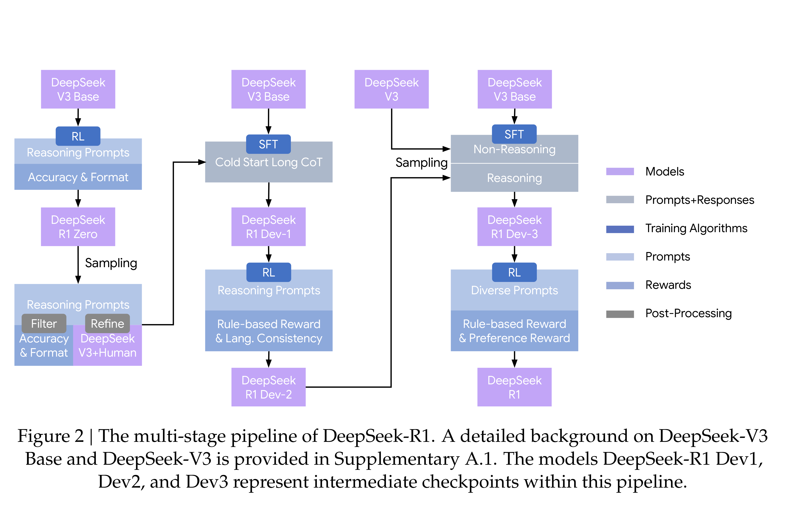

# DeepSeek-R1: Incentivizing Reasoning Capability in LLMs via Reinforcement Learning

[Official source](https://github.com/deepseek-ai/DeepSeek-R1)

## Abstract

General reasoning represents a long-standing and formidable challenge in artificial intelligence. Recent breakthroughs, exemplified by large language models (LLMs) (Brown et al., 2020; OpenAI, 2023) and chain-of-thought prompting (Wei et al., 2022b), have achieved considerable success on foundational reasoning tasks. However, this success is heavily contingent upon extensive human-annotated demonstrations, and models’ capabilities are still insufficient for more complex problems. Here we show that the reasoning abilities of LLMs can be incentivized through pure reinforcement learning (RL), obviating the need for human-labeled reasoning trajectories. The proposed RL framework facilitates the emergent development of advanced reasoning patterns, such as self-reflection, verification, and dynamic strategy adaptation. Consequently, the trained model achieves superior performance on verifiable tasks such as mathematics, coding competitions, and STEM fields, surpassing its counterparts trained via conventional supervised learning on human demonstrations. Moreover, the emergent reasoning patterns exhibited by these large-scale models can be systematically harnessed to guide and enhance the reasoning capabilities of smaller models.

Figure 2 | The multi-stage pipeline of DeepSeek-R1. A detailed background on DeepSeek-V3 Base and DeepSeek-V3 is provided in Supplementary A.1. The models DeepSeek-R1 Dev1, Dev2, and Dev3 represent intermediate checkpoints within this pipeline.

p. 6
