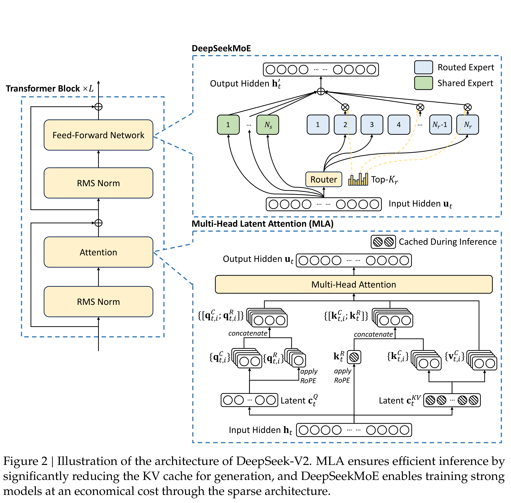

# DeepSeek-V2: A Strong, Economical, and Efficient Mixture-of-Experts Language Model

[Official source](https://github.com/deepseek-ai/DeepSeek-V2)

## Abstract

We present DeepSeek-V2, a strong Mixture-of-Experts (MoE) language model characterized by economical training and efficient inference. It comprises 236B total parameters, of which 21B are activated for each token, and supports a context length of 128K tokens. DeepSeek-V2 adopts innovative architectures including Multi-head Latent Attention (MLA) and DeepSeekMoE. MLA guarantees efficient inference through significantly compressing the Key-Value (KV) cache into a latent vector, while DeepSeekMoE enables training strong models at an economical cost through sparse computation. Compared with DeepSeek 67B, DeepSeek-V2 achieves significantly stronger performance, and meanwhile saves 42.5% of training costs, reduces the KV cache by 93.3%, and boosts the maximum generation throughput to 5.76 times. We pretrain DeepSeek-V2 on a high-quality and multi-source corpus consisting of 8.1T tokens, and further perform Supervised Fine-Tuning (SFT) and Reinforcement Learning (RL) to fully unlock its potential. Evaluation results show that, even with only 21B activated parameters, DeepSeek-V2 and its chat versions still achieve top-tier performance among open-source models. The model checkpoints are available at https://github.com/deepseek-ai/DeepSeek-V2.

Figure 2 | Illustration of the architecture of DeepSeek-V2. MLA ensures efficient inference by significantly reducing the KV cache for generation, and DeepSeekMoE enables training strong models at an economical cost through the sparse architecture.

p. 5
