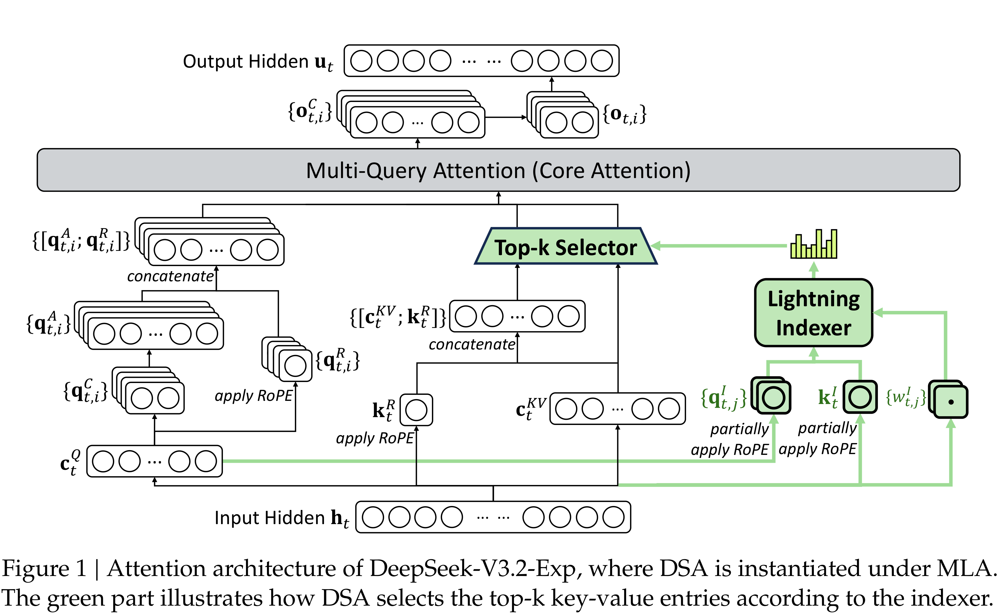

# DeepSeek-V3.2-Exp: Boosting Long-Context Efficiency with DeepSeek Sparse Attention

[Official source](https://github.com/deepseek-ai/DeepSeek-V3.2-Exp)

## Abstract

We introduce DeepSeek-V3.2-Exp, an experimental sparse-attention model, which equips DeepSeek-V3.1-Terminus with DeepSeek Sparse Attention (DSA) through continued training. With DSA, a fine-grained sparse attention mechanism powered by a lightning indexer, DeepSeek-V3.2-Exp achieves significant efficiency improvements in both training and inference, especially in long-context scenarios. The model checkpoints are available at https://huggingface.co/deepseek-ai/DeepSeek-V3.2-Exp.

Figure 1 | Attention architecture of DeepSeek-V3.2-Exp, where DSA is instantiated under MLA. The green part illustrates how DSA selects the top-k key-value entries according to the indexer.

p. 2
