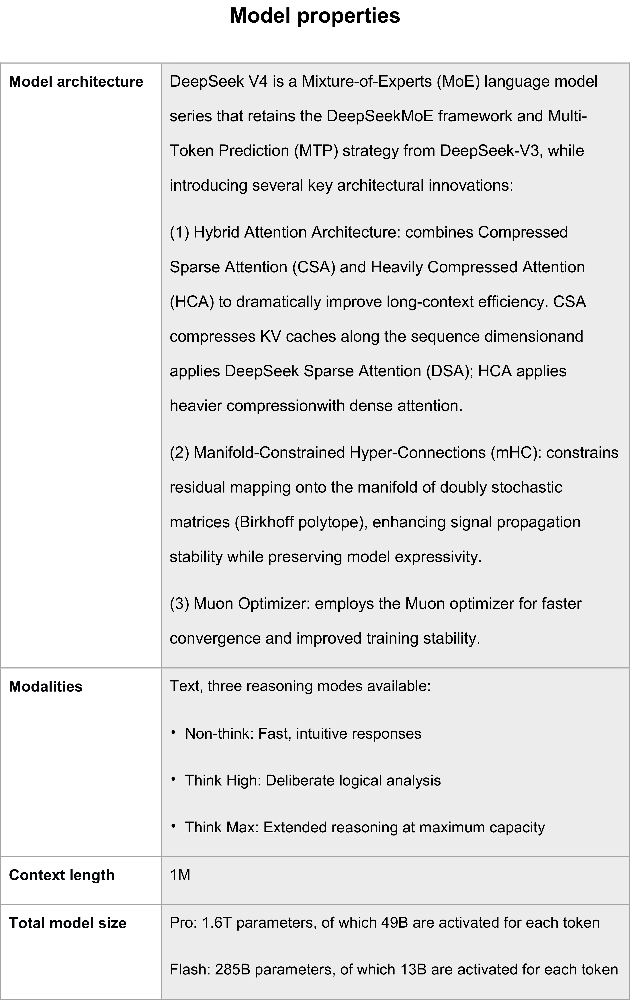

# DeepSeek V4 Technical Documentation (Model Card)

[Official source](https://www.deepseek.com/en/transparency/)

## Model architecture

DeepSeek V4 is a Mixture-of-Experts (MoE) language model series that retains the DeepSeekMoE framework and Multi-Token Prediction (MTP) strategy from DeepSeek-V3, while introducing several key architectural innovations:

(1) Hybrid Attention Architecture: combines Compressed Sparse Attention (CSA) and Heavily Compressed Attention (HCA) to dramatically improve long-context efficiency. CSA compresses KV caches along the sequence dimensionand applies DeepSeek Sparse Attention (DSA); HCA applies heavier compressionwith dense attention.

(2) Manifold-Constrained Hyper-Connections (mHC): constrains residual mapping onto the manifold of doubly stochastic matrices (Birkhoff polytope), enhancing signal propagation stability while preserving model expressivity.

(3) Muon Optimizer: employs the Muon optimizer for faster convergence and improved training stability.

## 1. Pre-training Phase

During the pre-training phase, corpus data is required for training. This phase primarily uses the following two categories of data: - Public Data: We use publicly available information on the internet to build the model's broad understanding of world knowledge. We employ technical methods to acquire and filter these freely accessible data to enrich the model's knowledge base. - Licensed Data: We collaborate with third-party data providers to obtain proprietary datasets through legally signed agreements.

p. 7

p. 3
