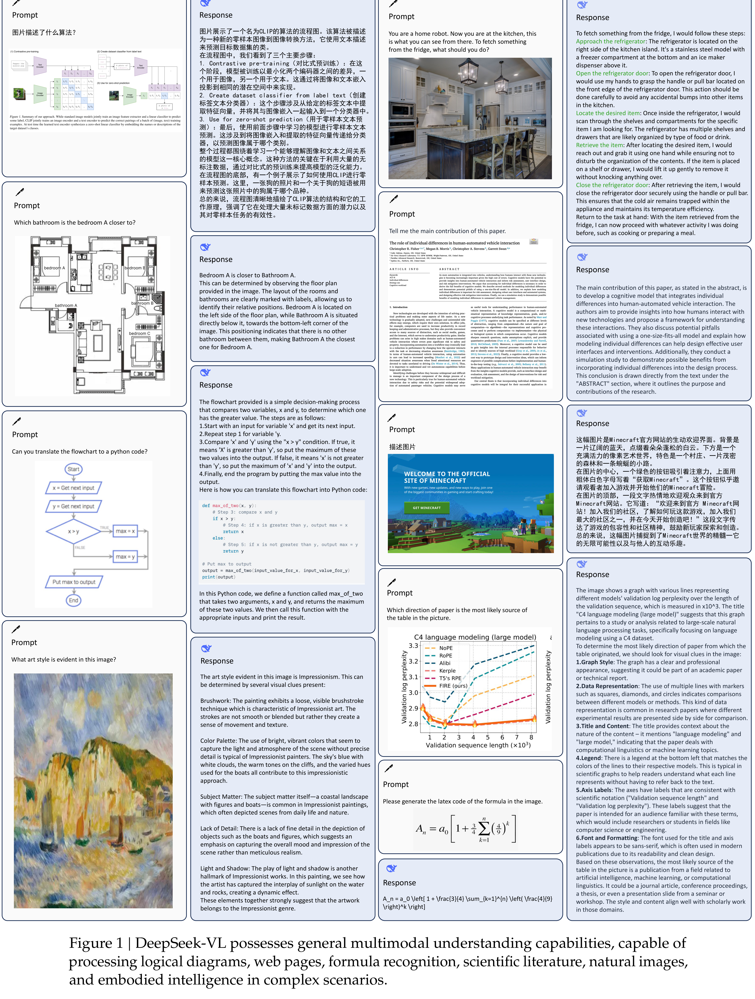

# DeepSeek-VL: Towards Real-World Vision-Language Understanding

[Official source](https://github.com/deepseek-ai/DeepSeek-VL)

## Abstract

We present DeepSeek-VL, an open-source Vision-Language (VL) Model designed for real-world vision and language understanding applications. Our approach is structured around three key dimensions:

• Data Construction: We strive to ensure our data is diverse, scalable and extensively covers real-world scenarios including web screenshots, PDFs, OCR, charts, and knowledge-based content (expert knowledge, textbooks), aiming for a comprehensive representation of practical contexts. Further, we create a use case taxonomy from real user scenarios and construct an instruction-tuning dataset accordingly. The fine-tuning with this dataset substantially improves the model’s user experience in practical applications.

• Model Architecture: Considering efficiency and the demands of most real-world scenarios, DeepSeek-VL incorporates a hybrid vision encoder that efficiently processes high-resolution images (1024 x 1024) within a fixed token budget, while maintaining a relatively low computational overhead. This design choice ensures the model’s ability to capture critical semantic and detailed information across various visual tasks.

• Training Strategy: We posit that a proficient Vision-Language Model should, foremost, possess strong language abilities. To ensure the preservation of LLM capabilities during pretraining, we investigate an effective VL pretraining strategy by integrating LLM training from the beginning and carefully managing the competitive dynamics observed between vision and language modalities. Starting with a focus on text, we gradually adjust the ratio to facilitate a balanced integration of both modalities. The DeepSeek-VL family (both 1.3B and 7B models) showcases superior user experiences as a vision-language chatbot in real-world applications, achieving state-of-the-art or competitive performance across a wide range of visual-language benchmarks at the same model size while maintaining robust performance on language-centric benchmarks. We have made both 1.3B and 7B models publicly accessible to foster innovations based on this foundation model.

Figure 1 | DeepSeek-VL possesses general multimodal understanding capabilities, capable of processing logical diagrams, web pages, formula recognition, scientific literature, natural images, and embodied intelligence in complex scenarios.

p. 4
