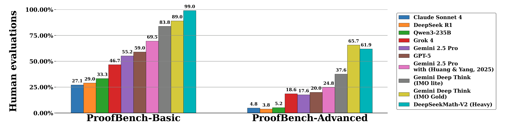

# DeepSeekMath-V2: Towards Self-Verifiable Mathematical Reasoning

[Official source](https://github.com/deepseek-ai/DeepSeek-Math-V2)

## Abstract

Large language models have made significant progress in mathematical reasoning, which serves as an important testbed for AI and could impact scientific research if further advanced. By scaling reasoning with reinforcement learning that rewards correct final answers, LLMs have improved from poor performance to saturating quantitative reasoning competitions like AIME and HMMT in one year. However, this approach faces fundamental limitations. Pursuing higher final answer accuracy doesn’t address a key issue: correct answers don’t guarantee correct reasoning. Moreover, many mathematical tasks like theorem proving require rigorous step-by-step derivation rather than numerical answers, making final answer rewards inapplicable. To push the limits of deep reasoning, we believe it is necessary to verify the comprehensiveness and rigor of mathematical reasoning. Self-verification is particularly important for scaling test-time compute, especially for open problems without known solutions. Towards self-verifiable mathematical reasoning, we investigate how to train an accurate and faithful LLM-based verifier for theorem proving. We then train a proof generator using the verifier as the reward model, and incentivize the generator to identify and resolve as many issues as possible in their own proofs before finalizing them. To maintain the generation-verification gap as the generator becomes stronger, we propose to scale verification compute to automatically label new hard-to-verify proofs, creating training data to further improve the verifier. Our resulting model, DeepSeekMath-V2, demonstrates strong theorem-proving capabilities, achieving gold-level scores on IMO 2025 and CMO 2024 and a near-perfect 118/120 on Putnam 2024 with scaled test-time compute. While much work remains, these results suggest that self-verifiable mathematical reasoning is a feasible research direction that may help develop more capable mathematical AI systems.

Figure 3 | Expert evaluation results on the Basic and Advanced subsets of IMO-ProofBench. All results are sourced from Luong et al. (2025), with the exception of DeepSeekMath-V2, which was evaluated by our experts following the grading guidelines.

p. 8
