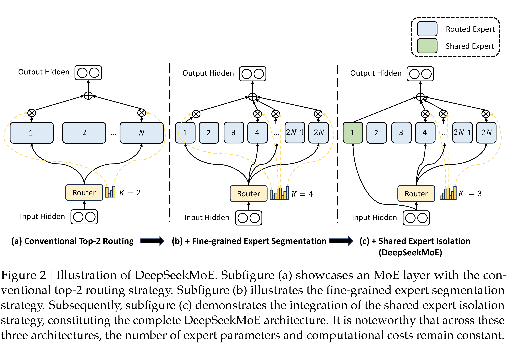

# DeepSeekMoE: Towards Ultimate Expert Specialization in Mixture-of-Experts Language Models

[Official source](https://github.com/deepseek-ai/DeepSeek-MoE)

## Abstract

In the era of large language models, Mixture-of-Experts (MoE) is a promising architecture for managing computational costs when scaling up model parameters. However, conventional MoE architectures like GShard, which activate the top-𝐾 out of 𝑁 experts, face challenges in ensuring expert specialization, i.e. each expert acquires non-overlapping and focused knowledge. In response, we propose the DeepSeekMoE architecture towards ultimate expert specialization. It involves two principal strategies: (1) finely segmenting the experts into 𝑚𝑁 ones and activating 𝑚𝐾 from them, allowing for a more flexible combination of activated experts; (2) isolating 𝐾𝑠 experts as shared ones, aiming at capturing common knowledge and mitigating redundancy in routed experts. Starting from a modest scale with 2B parameters, we demonstrate that DeepSeekMoE 2B achieves comparable performance with GShard 2.9B, which has 1.5× expert parameters and computation. In addition, DeepSeekMoE 2B nearly approaches the performance of its dense counterpart with the same number of total parameters, which set the upper bound of MoE models. Subsequently, we scale up DeepSeekMoE to 16B parameters and show that it achieves comparable performance with LLaMA2 7B, with only about 40% of computations. Further, our preliminary efforts to scale up DeepSeekMoE to 145B parameters consistently validate its substantial advantages over the GShard architecture, and show its performance comparable with DeepSeek 67B, using only 28.5% (maybe even 18.2%) of computations.

Figure 2 | Illustration of DeepSeekMoE. Subfigure (a) showcases an MoE layer with the conventional top-2 routing strategy. Subfigure (b) illustrates the fine-grained expert segmentation strategy. Subsequently, subfigure (c) demonstrates the integration of the shared expert isolation strategy, constituting the complete DeepSeekMoE architecture. It is noteworthy that across these three architectures, the number of expert parameters and computational costs remain constant.

p. 5
