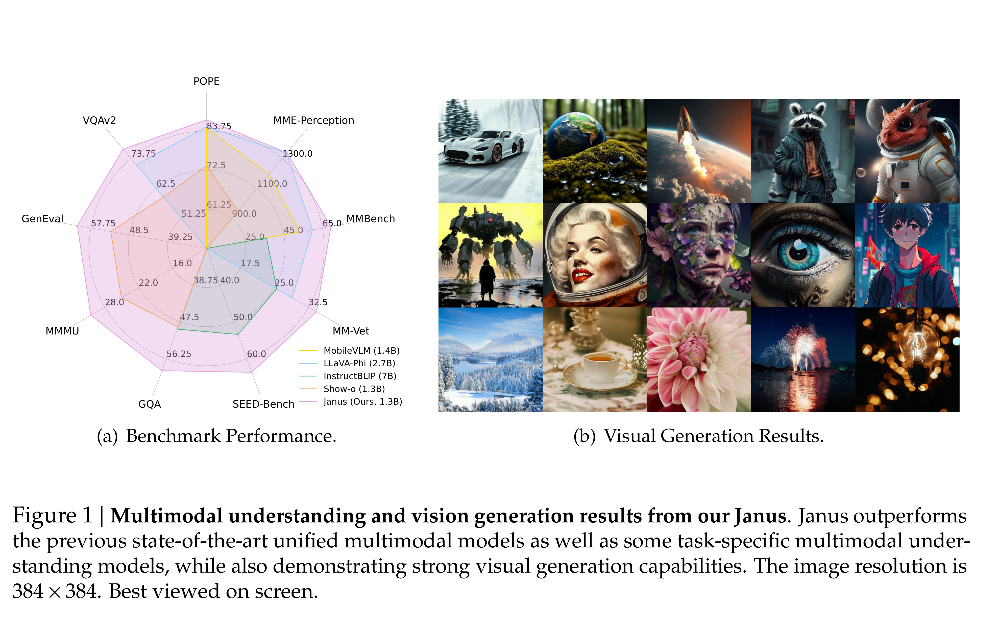

# Janus: Decoupling Visual Encoding for Unified Multimodal Understanding and Generation

[Official source](https://github.com/deepseek-ai/Janus)

## Abstract

In this paper, we introduce Janus, an autoregressive framework that unifies multimodal understanding and generation. Prior research often relies on a single visual encoder for both tasks, such as Chameleon. However, due to the differing levels of information granularity required by multimodal understanding and generation, this approach can lead to suboptimal performance, particularly in multimodal understanding. To address this issue, we decouple visual encoding into separate pathways, while still leveraging a single, unified transformer architecture for processing. The decoupling not only alleviates the conflict between the visual encoder’s roles in understanding and generation, but also enhances the framework’s flexibility. For instance, both the multimodal understanding and generation components can independently select their most suitable encoding methods. Experiments show that Janus surpasses previous unified model and matches or exceeds the performance of task-specific models. The simplicity, high flexibility, and effectiveness of Janus make it a strong candidate for next-generation unified multimodal models.

Figure 1 | Multimodal understanding and vision generation results from our Janus. Janus outperforms the previous state-of-the-art unified multimodal models as well as some task-specific multimodal understanding models, while also demonstrating strong visual generation capabilities. The image resolution is 384 × 384. Best viewed on screen.

p. 2
