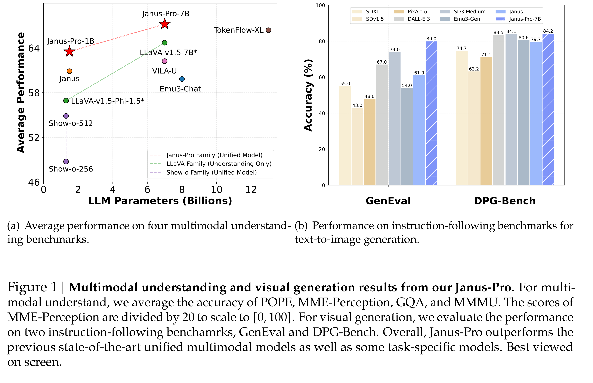

# Janus-Pro: Unified Multimodal Understanding and Generation with Data and Model Scaling

[Official source](https://github.com/deepseek-ai/Janus)

## Abstract

In this work, we introduce Janus-Pro, an advanced version of the previous work Janus. Specifically, Janus-Pro incorporates (1) an optimized training strategy, (2) expanded training data, and (3) scaling to larger model size. With these improvements, Janus-Pro achieves significant advancements in both multimodal understanding and text-to-image instruction-following capabilities, while also enhancing the stability of text-to-image generation. We hope this work will inspire further exploration in the field. Code and models are publicly available.

Figure 1 | Multimodal understanding and visual generation results from our Janus-Pro. For multimodal understand, we average the accuracy of POPE, MME-Perception, GQA, and MMMU. The scores of MME-Perception are divided by 20 to scale to [0, 100]. For visual generation, we evaluate the performance on two instruction-following benchamrks, GenEval and DPG-Bench. Overall, Janus-Pro outperforms the previous state-of-the-art unified multimodal models as well as some task-specific models. Best viewed on screen.

p. 1
