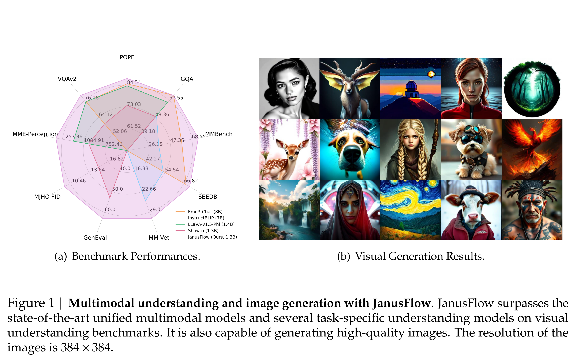

# JanusFlow: Harmonizing Autoregression and Rectified Flow for Unified Multimodal Understanding and Generation

[Official source](https://github.com/deepseek-ai/Janus)

## Abstract

We present JanusFlow, a powerful framework that unifies image understanding and generation in a single model. JanusFlow introduces a minimalist architecture that integrates autoregressive language models with rectified flow, a state-of-the-art method in generative modeling. Our key finding demonstrates that rectified flow can be straightforwardly trained within the large language model framework, eliminating the need for complex architectural modifications. To further improve the performance of our unified model, we adopt two key strategies: (i) decoupling the understanding and generation encoders, and (ii) aligning their representations during unified training. Extensive experiments show that JanusFlow achieves comparable or superior performance to specialized models in their respective domains, while significantly outperforming existing unified approaches across standard benchmarks. This work represents a step toward more efficient and versatile vision-language models.

Figure 1 | Multimodal understanding and image generation with JanusFlow. JanusFlow surpasses the state-of-the-art unified multimodal models and several task-specific understanding models on visual understanding benchmarks. It is also capable of generating high-quality images. The resolution of the images is 384 × 384.

p. 2
