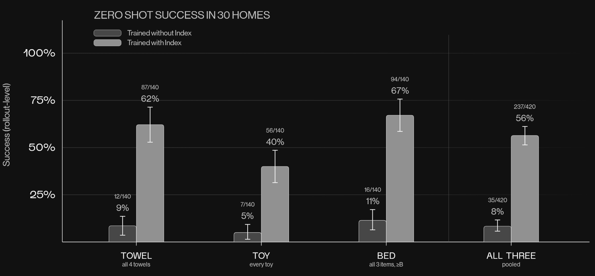
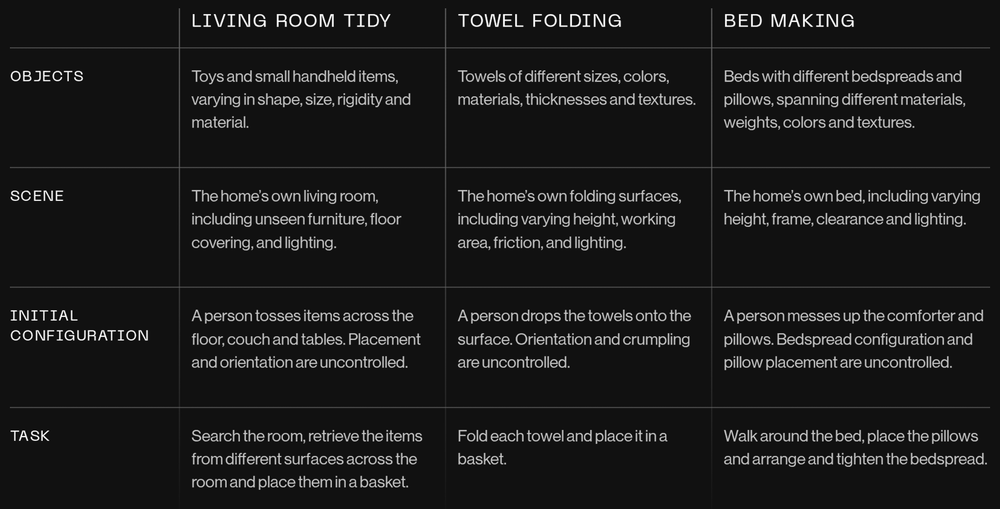

# Helix 2.5

[Official source](https://www.figure.ai/news/helix-2-5-zero-shot-30-home-generalization)

Today we are introducing Helix 2.5, the most advanced neural network Figure has built.

Helix 02 showed that a neural policy could coordinate a humanoid's whole body over long horizons, from unloading a dishwasher to running a logistics task autonomously for 200 hours. But those systems learned from data collected where the robots would operate.

Helix 2.5 was built to answer a harder question: can a humanoid enter a home it has never seen and immediately get to work, with its whole body, on its own?

To find out, we pretrained Helix 2.5 on Index, Figure's global-scale dataset of human behavior. From that single foundation model, we produced three behaviors: tidying living rooms, folding towels, and making beds. Then we took the robot into 30 Bay Area homes with zero data collected in any of them.

Figure 1: Zero-Shot Success in 30 Homes: Success rates of models trained from scratch vs. models trained with Index. Index accounts for the majority of Helix 2.5's zero-shot capability.

Table 1: Evaluation Task Definitions and Setup
