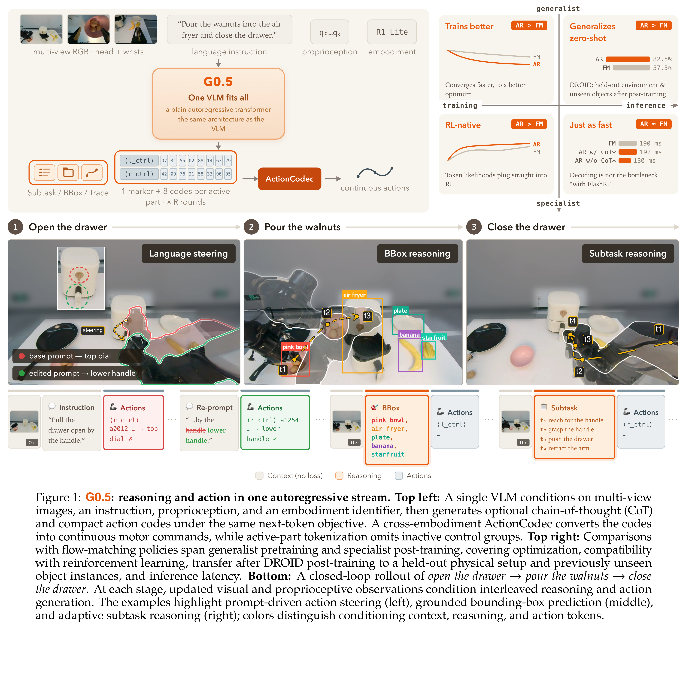
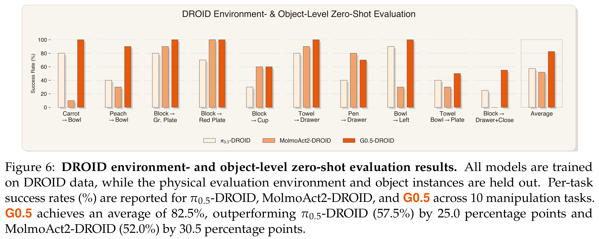

# G0.5: One Autoregressive Stream for Robot Reasoning and Action

[Official source](https://arxiv.org/abs/2608.11739)

## Abstract

The prevailing recipe for Vision-Language-Action (VLA) models couples a pretrained VLM with a separately trained flow-matching action expert. This makes the VLM a context encoder rather than a decision-maker. Instead, we argue for focusing on the VLM backbone: a unified model with a single set of weights that generates both reasoning and actions within a single autoregressive token stream.

We introduce G0.5, a pretrained autoregressive VLA in which a single transformer decoder emits reasoning and action tokens under a single objective. Three components make this tractable at foundation-model scale: a learnable cross-embodiment action tokenizer that maps heterogeneous robot actions into a shared vocabulary; a native chain-of-thought stream interleaving task decomposition, object grounding, and action hints with action tokens; and a visual memory module that injects multi-second history through the vision encoder. Because reasoning and action share a single set of weights, the pretrained VLM’s capabilities carry over to physical behavior: the model follows instructions closely, and prompts directly steer action granularity, task horizon, and out-of-distribution scene handling without further training. Pretrained on a large collection of robot datasets together with VQA samples, G0.5 surpasses state-of-the-art models across 7 independent regimes: real-world fine-tuning on R1-Lite/R1-Pro robots (76.7% vs. 53.3% for 𝜋0.5 and 24.4% for GR00T-N1.7), the 2025 BEHAVIOR Challenge on 50 long-horizon household mobile manipulation tasks using a generalist policy (31.4% vs. 26.3% for 𝜋0.5 and 26.1% for the challenge winner), DROID post-training followed by zero-shot transfer to an unseen environment and objects (82.5%), a language-following Pick-and-Place benchmark, LIBERO (98.9%), RoboTwin 2.0 (93.3%), and SimplerEnv-Bridge (87.3%).

Figure 1: G0.5: reasoning and action in one autoregressive stream. Top left: A single VLM conditions on multi-view images, an instruction, proprioception, and an embodiment identifier, then generates optional chain-of-thought (CoT) and compact action codes under the same next-token objective. A cross-embodiment ActionCodec converts the codes into continuous motor commands, while active-part tokenization omits inactive control groups. Top right: Comparisons with flow-matching policies span generalist pretraining and specialist post-training, covering optimization, compatibility with reinforcement learning, transfer after DROID post-training to a held-out physical setup and previously unseen object instances, and inference latency. Bottom: A closed-loop rollout of open the drawer →pour the walnuts →close the drawer. At each stage, updated visual and proprioceptive observations condition interleaved reasoning and action generation. The examples highlight prompt-driven action steering (left), grounded bounding-box prediction (middle), and adaptive subtask reasoning (right); colors distinguish conditioning context, reasoning, and action tokens.

p. 1

Figure 6: DROID environment- and object-level zero-shot evaluation results. All models are trained on DROID data, while the physical evaluation environment and object instances are held out. Per-task success rates (%) are reported for 𝜋0.5-DROID, MolmoAct2-DROID, and G0.5 across 10 manipulation tasks. G0.5 achieves an average of 82.5%, outperforming 𝜋0.5-DROID (57.5%) by 25.0 percentage points and MolmoAct2-DROID (52.0%) by 30.5 percentage points.

p. 12
