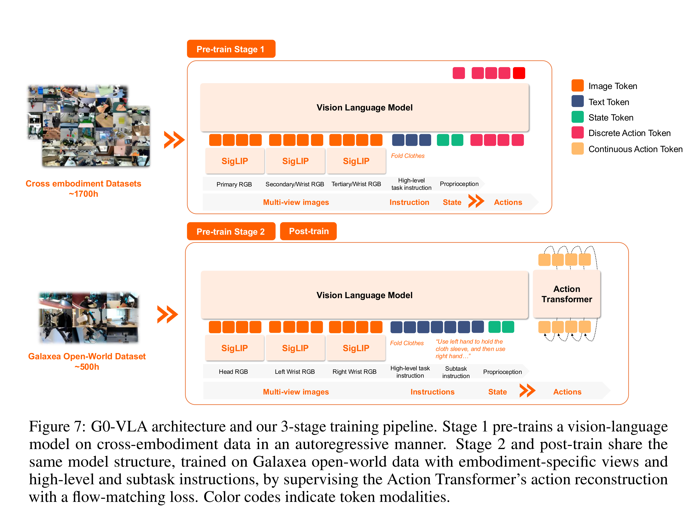
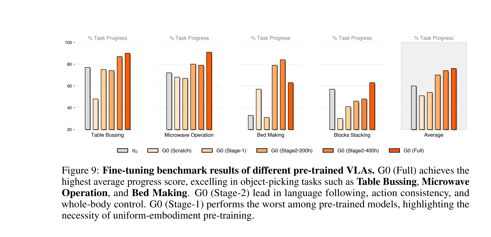

# Galaxea Open-World Dataset and G0 Dual-System VLA Model

[Official source](https://arxiv.org/abs/2509.00576)

## Abstract

We present Galaxea Open-World Dataset, a large-scale, diverse collection of robot behaviors recorded in authentic human living and working environments. All demonstrations are gathered using a consistent robotic embodiment, paired with precise subtask-level language annotations to facilitate both training and evalu- ation. Building on this dataset, we introduce G0, a dual-system framework that couples a Vision-Language Model (VLM) for multimodal planning with a Vision- Language-Action (VLA) model for fine-grained execution. G0 is trained using a three-stage curriculum: cross-embodiment pre-training, single-embodiment pre- training, and task-specific post-training. A comprehensive benchmark—spanning tabletop manipulation, few-shot learning, and long-horizon mobile manipula- tion—demonstrates the effectiveness of our approach. In particular, we find that the single-embodiment pre-training stage, together with the Galaxea Open-World Dataset, plays a critical role in achieving strong performance.

Figure 7: G0-VLA architecture and our 3-stage training pipeline. Stage 1 pre-trains a vision-language model on cross-embodiment data in an autoregressive manner. Stage 2 and post-train share the same model structure, trained on Galaxea open-world data with embodiment-specific views and high-level and subtask instructions, by supervising the Action Transformer’s action reconstruction with a flow-matching loss. Color codes indicate token modalities.

p. 8

Figure 9: Fine-tuning benchmark results of different pre-trained VLAs. G0 (Full) achieves the highest average progress score, excelling in object-picking tasks such as Table Bussing, Microwave Operation, and Bed Making. G0 (Stage-2) lead in language following, action consistency, and whole-body control. G0 (Stage-1) performs the worst among pre-trained models, highlighting the necessity of uniform-embodiment pre-training.

p. 10
