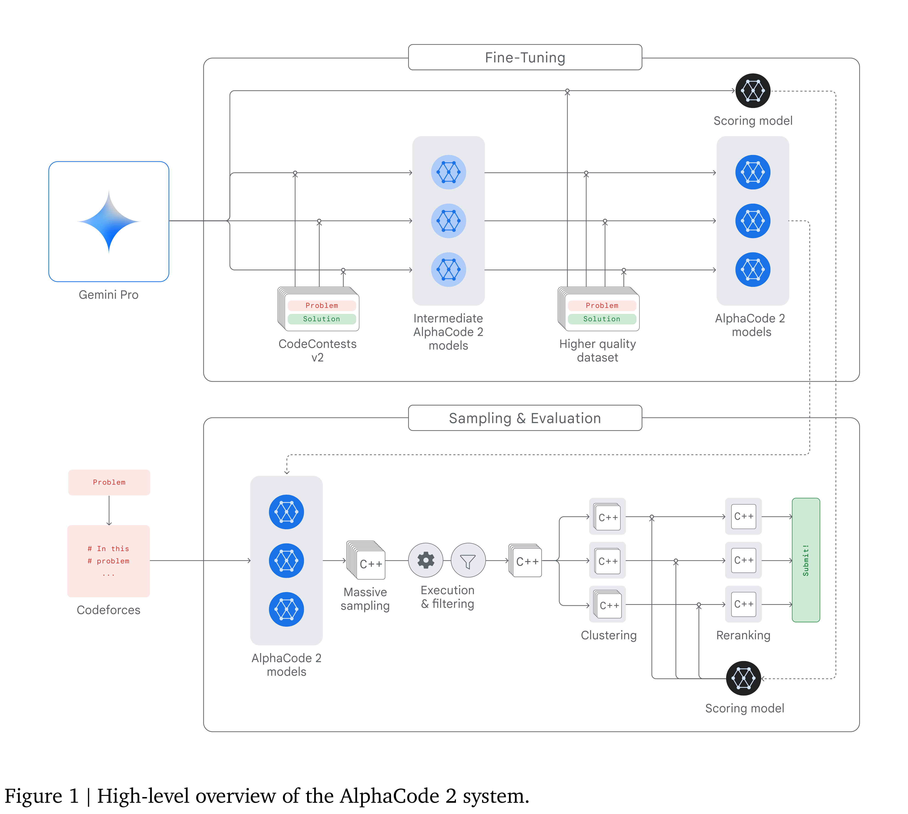
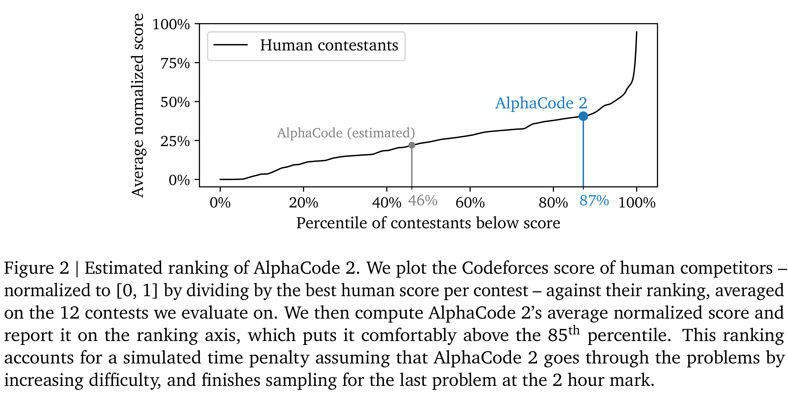

# AlphaCode 2 Technical Report

[Official source](https://deepmind.google/AlphaCode2_Tech_Report.pdf)

## Introduction

Competitive programming is one of the ultimate litmus tests of coding skills. Participants are given limited time to write code to solve complex problems that require critical thinking, logic, and understanding of algorithms, coding and natural language. As such, it is a great benchmark for advanced reasoning and problem solving abilities.

AlphaCode (Li et al., 2022) was the first AI system to reach a competitive level on this task. Its successor, AlphaCode 2, leverages several Gemini-based (Gemini Team, Google, 2023) models as part of a massively improved system. When evaluated on the Codeforces platform – a mainstay of competitive programming – AlphaCode 2 solves 43% of problems within 10 attempts, close to twice as many problems as the original AlphaCode (25%). While its predecessor performed at the level of the median competitor, we estimate that AlphaCode 2 reaches the 85th percentile on average.

Adopting Gemini as the foundation model for all components of AlphaCode 2 was key to achieving this level of performance. AlphaCode 2’s success underlines Gemini’s flexibility and adaptability, as we were able to fine-tune it and optimize performance for several different tasks including code generation and code reranking.

Figure 1 | High-level overview of the AlphaCode 2 system.

p. 2

Figure 2 | Estimated ranking of AlphaCode 2. We plot the Codeforces score of human competitors –
normalized to [0, 1] by dividing by the best human score per contest – against their ranking, averaged
on the 12 contests we evaluate on. We then compute AlphaCode 2’s average normalized score and
report it on the ranking axis, which puts it comfortably above the 85th percentile. This ranking
accounts for a simulated time penalty assuming that AlphaCode 2 goes through the problems by
increasing difficulty, and finishes sampling for the last problem at the 2 hour mark.

p. 4
