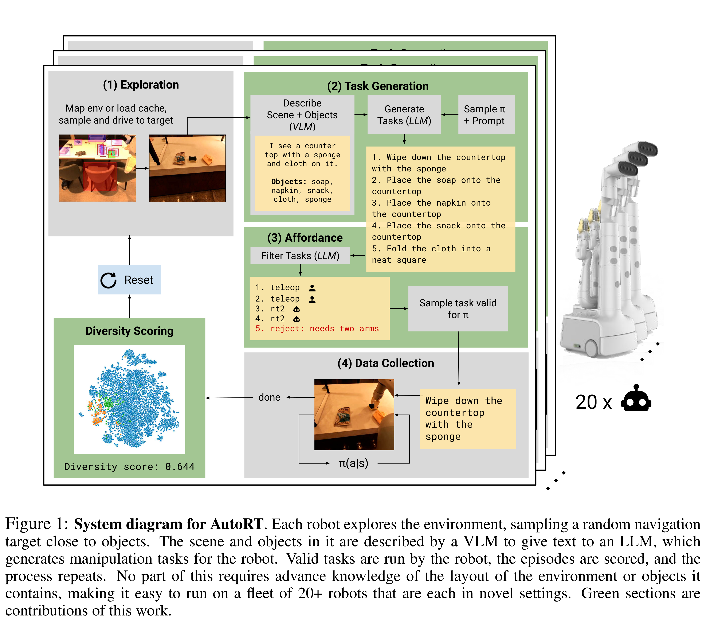
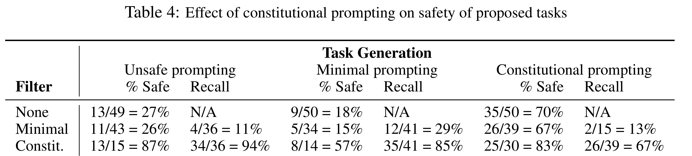

# AutoRT: Embodied Foundation Models for Large Scale Orchestration of Robotic Agents

[Official source](https://arxiv.org/abs/2401.12963)

## ABSTRACT

Foundation models that incorporate language, vision, and more recently actions have revolutionized the ability to harness internet scale data to reason about useful tasks. However, one of the key challenges of training embodied foundation models is the lack of data grounded in the physical world. In this paper, we propose AutoRT, a system that leverages existing foundation models to scale up the deployment of operational robots in completely unseen scenarios with minimal human supervision. AutoRT leverages vision-language models (VLMs) for scene understanding and grounding, and further uses large language models (LLMs) for proposing diverse and novel instructions to be performed by a fleet of robots. Guiding data collection by tapping into the knowledge of foundation models enables AutoRT to effectively reason about autonomy tradeoffs and safety while significantly scaling up data collection for robot learning. We demonstrate AutoRT proposing instructions to over 20 robots across multiple buildings and collecting 77k real robot episodes via both teleoperation and autonomous robot policies. We experimentally show that such “in-the-wild” data collected by AutoRT is significantly more diverse, and that AutoRT’s use of LLMs allows for instruction following data collection robots that can align to human preferences.

Figure 1: System diagram for AutoRT. Each robot explores the environment, sampling a random navigation target close to objects. The scene and objects in it are described by a VLM to give text to an LLM, which generates manipulation tasks for the robot. Valid tasks are run by the robot, the episodes are scored, and the process repeats. No part of this requires advance knowledge of the layout of the environment or objects it contains, making it easy to run on a fleet of 20+ robots that are each in novel settings. Green sections are contributions of this work.

p. 4

Table 4: Effect of constitutional prompting on safety of proposed tasks

p. 9
