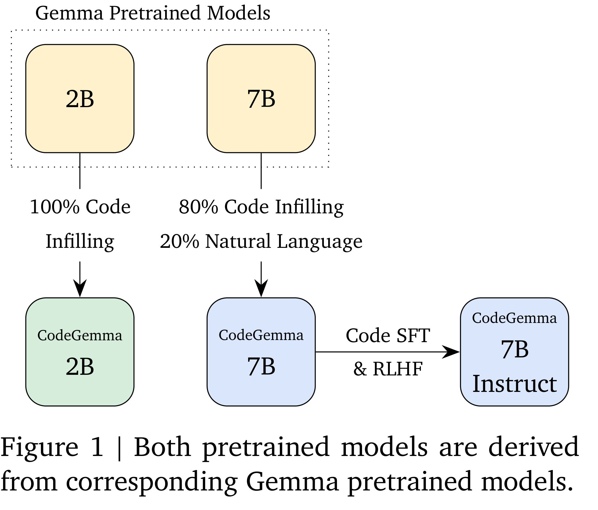
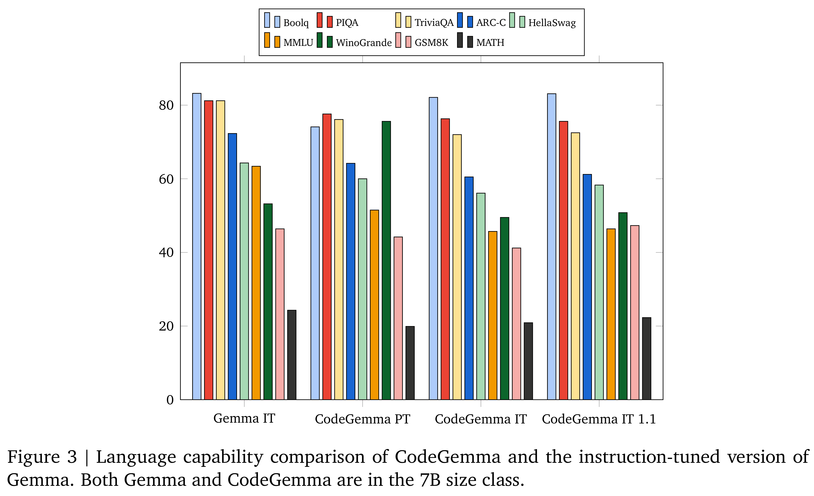

# CodeGemma: Open Code Models Based on Gemma

[Official source](https://deepmind.google/models/gemma/codegemma/)

This paper introduces CodeGemma, a collection of specialized open code models built on top of Gemma, capable of a variety of code and natural language generation tasks. We release three model variants. CodeGemma 7B pretrained (PT) and instruction-tuned (IT) variants have remarkably resilient natural language understanding, excel in mathematical reasoning, and match code capabilities of other open models. CodeGemma 2B is a state-of-the-art code completion model designed for fast code infilling and open-ended generation in latency-sensitive settings.

Figure 1 | Both pretrained models are derived from corresponding Gemma pretrained models.

p. 1

Figure 3 | Language capability comparison of CodeGemma and the instruction-tuned version of Gemma. Both Gemma and CodeGemma are in the 7B size class.

p. 5
