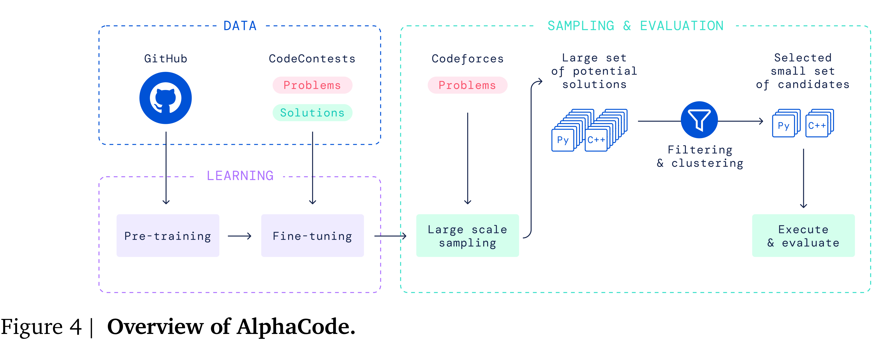

# Competition-Level Code Generation with AlphaCode

[Official source](https://arxiv.org/abs/2203.07814)

## 1. Introduction

Computer programming has emerged as a general-purpose problem-solving tool throughout science, industry, and daily life. As part of this growth, there has been continuously increasing demand for tools that can make programmers more productive (Matsakis and Klock, 2014), or make programming and programming education more accessible (Resnick et al., 2009). Developing AI systems that can effectively model and understand code can transform these tools and the way we interact with them. Systems that can generate code are not only useful, but also stepping stones that can lead to greater understanding of AI and how it relates to programming.

Generating code that solves a specified task requires searching in the huge structured space of possible programs, with a very sparse reward signal. Single character edits can completely change program behaviour even if they don’t cause crashes, solutions can look dramatically different even for the same problem, and judging if a partial or incorrect program is useful is a difficult challenge. Therefore, most prior work has been limited to either restricted domain-specific programming languages (Gulwani, 2011) or short code snippets (Bruch et al., 2009; Raychev et al., 2014).

Recent large-scale transformer-based (Vaswani et al., 2017) language models, used to achieve impressive performance generating text (Brown et al., 2020), have successfully generated code that solves simple programming problems in Python (Austin et al., 2021; Chen et al., 2021). A stripped-down version of our model, without the modifications described in Section 4, performs similarly to Codex (Table A3). However, problems used in the Codex paper and similar work consist of mostly simple task descriptions with short solutions – far from the full complexity of real-world programming. Generating an entire program in a general-purpose programming language such as C++ or Python, starting from a long natural language task description, has remained an open problem. The difference in difficulty between generating short code snippets and entire programs can be analogous to that of imperative versus declarative problem solving. Generating short code snippets typically amounts to translating the task specification directly into code, and sometimes reduces to invoking the correct API calls. In contrast, generating entire programs often relies on understanding the task and figuring out how to accomplish it, which requires deeper algorithmic reasoning.

Competitive programming problems represent a significant step forward in all these aspects. Solving such problems requires understanding complex natural language descriptions, reasoning about previously unseen problems, mastering a wide range of algorithms and data structures, and precisely implementing solutions that can span hundreds of lines. Solutions are evaluated by executing them on an exhaustive suite of unknown tests, checking for correct behaviour on edge cases as well as execution speed. The fact that the test cases used for evaluation are hidden is an important part of the challenge. These complex problems are newly created for each competition, with the understanding that competitors can draw on solutions to previous contests (either implicitly, by remembering old problems, or explicitly, by searching for them). Moreover, competitive programming is very popular; events like the International Collegiate Programming Competition (ICPC, 2021) and the International Olympiad in Informatics (IOI, 2021) are widely recognized as some of the most prestigious competitions in computer science, drawing hundreds of thousands of participants from around the world. Using problems that humans find challenging from such battle-tested competitions ensures robustness against shortcuts and provides a meaningful benchmark for many aspects of intelligence.

Early work using program synthesis for competitive programming has shown that large transformer models can achieve low single-digit solve rates (Chen et al., 2021; Hendrycks et al., 2021), but could not yet reliably generate solutions for the vast majority of problems. Furthermore, as we show in Section 3.2.1, the lack of sufficient test cases in existing competitive programming datasets makes

(a) AlphaCode’s ranking in 10 contests

(b) AlphaCode’s estimated rating

the metrics defined on them prone to high false positive rates (with 30% or more programs which pass all tests but are not actually correct), and therefore unreliable for measuring research progress.

In this paper we present AlphaCode, a code generation system applied to solving competitive programming problems. We use large transformer language models to generate code, pre-training them on selected GitHub code and fine-tuning on our curated set of competitive programming problems. For each unseen problem we generate a large set of program samples, filter them based on execution results on example tests from the problem description, then cluster the remaining samples to obtain a small set of candidates to be submitted for evaluation. We describe AlphaCode in detail in Section 4.

A core part of developing our system was ensuring that submissions are rigorously evaluated and that evaluation problems are truly unseen during training, so difficult problems cannot be solved by copying from the training set. Towards this goal, we release a new training and evaluation competitive programming dataset, CodeContests1 (Section 3). This dataset combines data from various sources, splits temporally so all training data predates all evaluation problems, adds additional generated tests to ensure correctness, and evaluates submissions in a setting that mirrors that of competitive programming. In our evaluation (Section 3.2.1), CodeContests reduces the false positive rate from 30-60% in existing datasets to just 4%. Our best model solves 34.2% of held-out competitive programming problems in this dataset, using at most 10 submissions per problem (comparable to humans), as opposed to previously reported solve rates of around 1-5% on existing datasets (see Section 5.4).

To further validate our results, we evaluated AlphaCode on simulated programming competitions hosted on the popular Codeforces platform2 (Section 5.1). In the evaluation of 10 recent contests with over 5,000 participants each, AlphaCode achieved an average ranking within the top 54.3%. Based on these results, we estimate that our system has achieved a Codeforces rating3 of 1238 which is within the top 28%4 of users who have participated in a contest in the last 6 months (Figure 1)

(Ebtekar, 2021). These evaluations only include users who have tried such competitions, which is a self-selected subset of all programmers. This is the first time that a computer system has achieved such a competitive level in programming competitions.

We also performed a detailed analysis of our system (Section 6), showing that AlphaCode does not duplicate sections of code from the training dataset to solve problems, but instead relies heavily on the natural language problem descriptions to create original solutions. We further examine the types of problems the model can and cannot solve, and discuss how the validation loss is a poor proxy for the solve rate.

Figure 4 | Overview of AlphaCode.

p. 9
