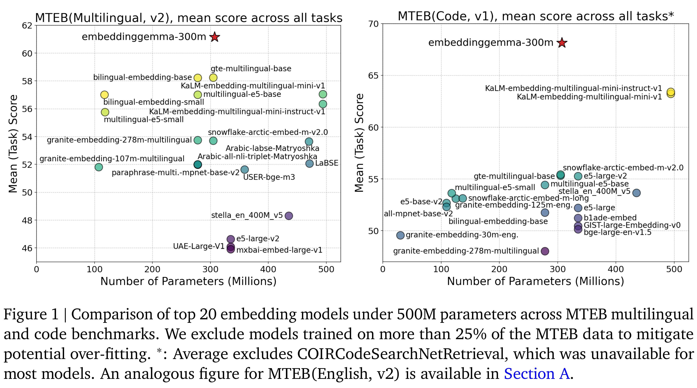
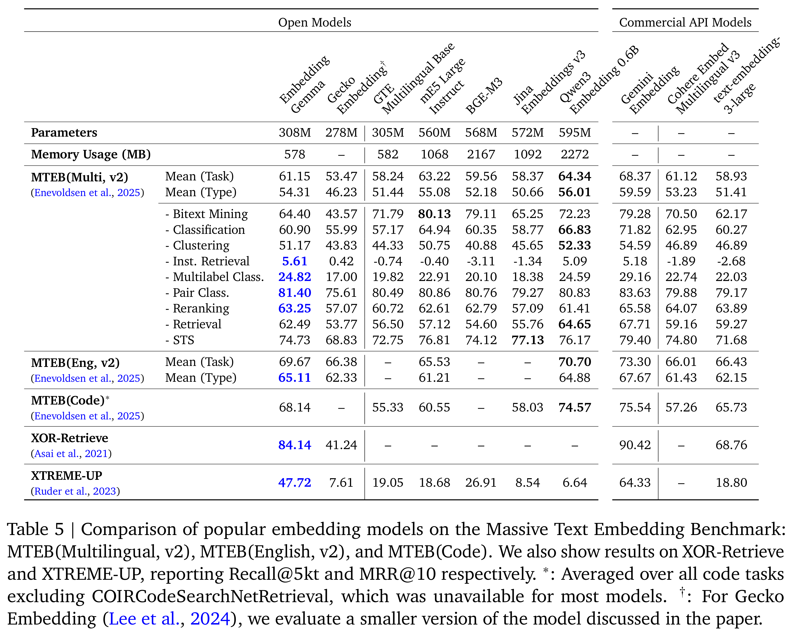

# EmbeddingGemma: Powerful and Lightweight Text Representations

[Official source](https://arxiv.org/abs/2509.20354)

We introduce EmbeddingGemma, a new lightweight, open text embedding model based on the Gemma 3 language model family. Our innovative training recipe strategically captures knowledge from larger models via encoder-decoder initialization and geometric embedding distillation. We improve model robustness and expressiveness with a spread-out regularizer, and ensure generalizability by merging checkpoints from varied, optimized mixtures. Evaluated on the Massive Text Embedding Benchmark (MTEB) across multilingual, English, and code domains, EmbeddingGemma (300M) achieves state- of-the-art results. Notably, it outperforms prior top models, both proprietary and open, with fewer than 500M parameters, and provides performance comparable to models double its size, offering an exceptional performance-to-cost ratio. Remarkably, this lead persists when quantizing model weights or truncating embedding outputs. This makes EmbeddingGemma particularly well-suited for low-latency and high-throughput use cases such as on-device applications. We provide ablation studies exploring our key design choices. We release EmbeddingGemma to the community to promote further research.

Figure 1 | Comparison of top 20 embedding models under 500M parameters across MTEB multilingual
and code benchmarks. We exclude models trained on more than 25% of the MTEB data to mitigate
potential over-fitting. ∗: Average excludes COIRCodeSearchNetRetrieval, which was unavailable for
most models. An analogous figure for MTEB(English, v2) is available in Section A.

p. 2

Table 5 | Comparison of popular embedding models on the Massive Text Embedding Benchmark:
MTEB(Multilingual, v2), MTEB(English, v2), and MTEB(Code). We also show results on XOR-Retrieve
and XTREME-UP, reporting Recall@5kt and MRR@10 respectively. ∗: Averaged over all code tasks
excluding COIRCodeSearchNetRetrieval, which was unavailable for most models.
†: For Gecko
Embedding (Lee et al., 2024), we evaluate a smaller version of the model discussed in the paper.

p. 8
