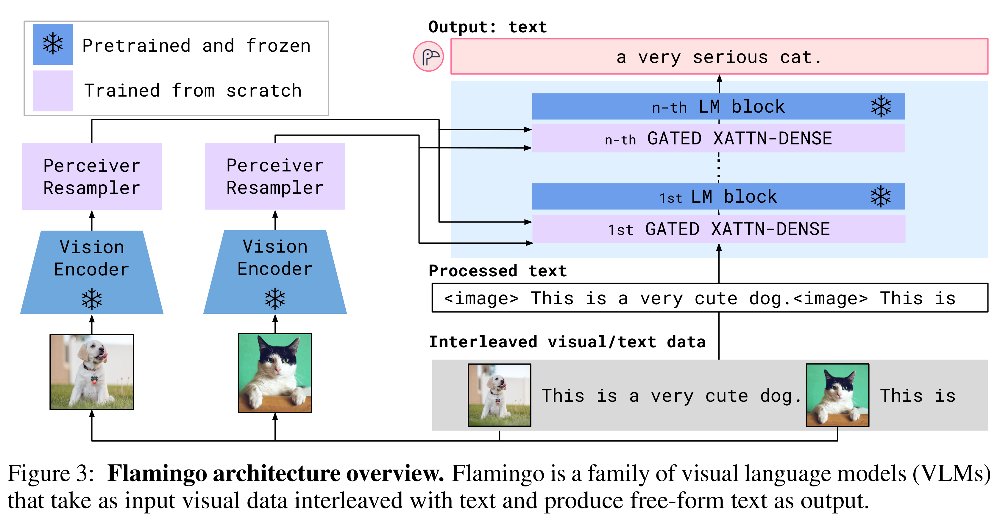

# Flamingo: a Visual Language Model for Few-Shot Learning

[Official source](https://arxiv.org/abs/2204.14198)

## Abstract

Building models that can be rapidly adapted to novel tasks using only a handful of annotated examples is an open challenge for multimodal machine learning research. We introduce Flamingo, a family of Visual Language Models (VLM) with this ability. We propose key architectural innovations to: (i) bridge powerful pretrained vision-only and language-only models, (ii) handle sequences of arbitrarily interleaved visual and textual data, and (iii) seamlessly ingest images or videos as inputs. Thanks to their flexibility, Flamingo models can be trained on large-scale multimodal web corpora containing arbitrarily interleaved text and images, which is key to endow them with in-context few-shot learning capabilities. We perform a thorough evaluation of our models, exploring and measuring their ability to rapidly adapt to a variety of image and video tasks. These include open-ended tasks such as visual question-answering, where the model is prompted with a question which it has to answer; captioning tasks, which evaluate the ability to describe a scene or an event; and close-ended tasks such as multiple-choice visual question-answering. For tasks lying anywhere on this spectrum, a single Flamingo model can achieve a new state of the art with few-shot learning, simply by prompting the model with task-specific examples. On numerous benchmarks, Flamingo outperforms models fine-tuned on thousands of times more task-specific data.

Corresponding authors: {jalayrac|jeffdonahue|paulineluc|miech}@deepmind.com 36th Conference on Neural Information Processing Systems (NeurIPS 2022).

Input Prompt

−→

Completion

−→

−→

−→

−→

−→

Figure 3: Flamingo architecture overview. Flamingo is a family of visual language models (VLMs) that take as input visual data interleaved with text and produce free-form text as output.

p. 4
