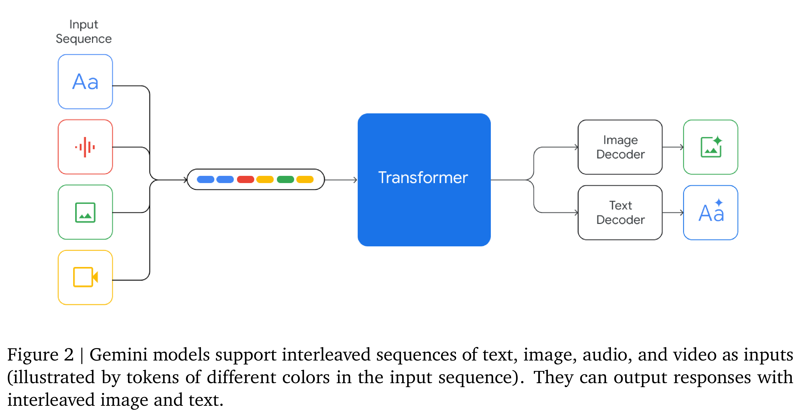
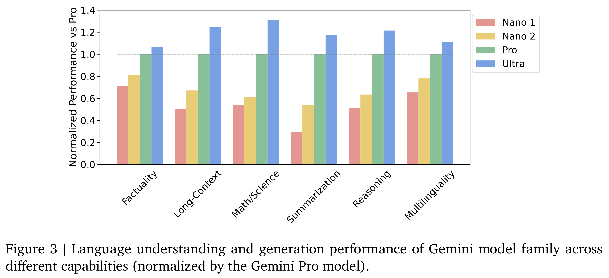

# Gemini 1.0 Technical Report

[Official source](https://storage.googleapis.com/deepmind-media/gemini/gemini_1_report.pdf#page=71)

This report introduces a new family of multimodal models, Gemini, that exhibit remarkable capabilities across image, audio, video, and text understanding. The Gemini family consists of Ultra, Pro, and Nano sizes, suitable for applications ranging from complex reasoning tasks to on-device memory-constrained use-cases. Evaluation on a broad range of benchmarks shows that our most-capable Gemini Ultra model advances the state of the art in 30 of 32 of these benchmarks — notably being the first model to achieve human-expert performance on the well-studied exam benchmark MMLU, and improving the state of the art in every one of the 20 multimodal benchmarks we examined. We believe that the new capabilities of the Gemini family in cross-modal reasoning and language understanding will enable a wide variety of use cases. We discuss our approach toward post-training and deploying Gemini models responsibly to users through services including Gemini, Gemini Advanced, Google AI Studio, and Cloud Vertex AI.

Figure 2 | Gemini models support interleaved sequences of text, image, audio, and video as inputs
(illustrated by tokens of different colors in the input sequence). They can output responses with

p. 4

Figure 3 | Language understanding and generation performance of Gemini model family across
different capabilities (normalized by the Gemini Pro model).

p. 9
