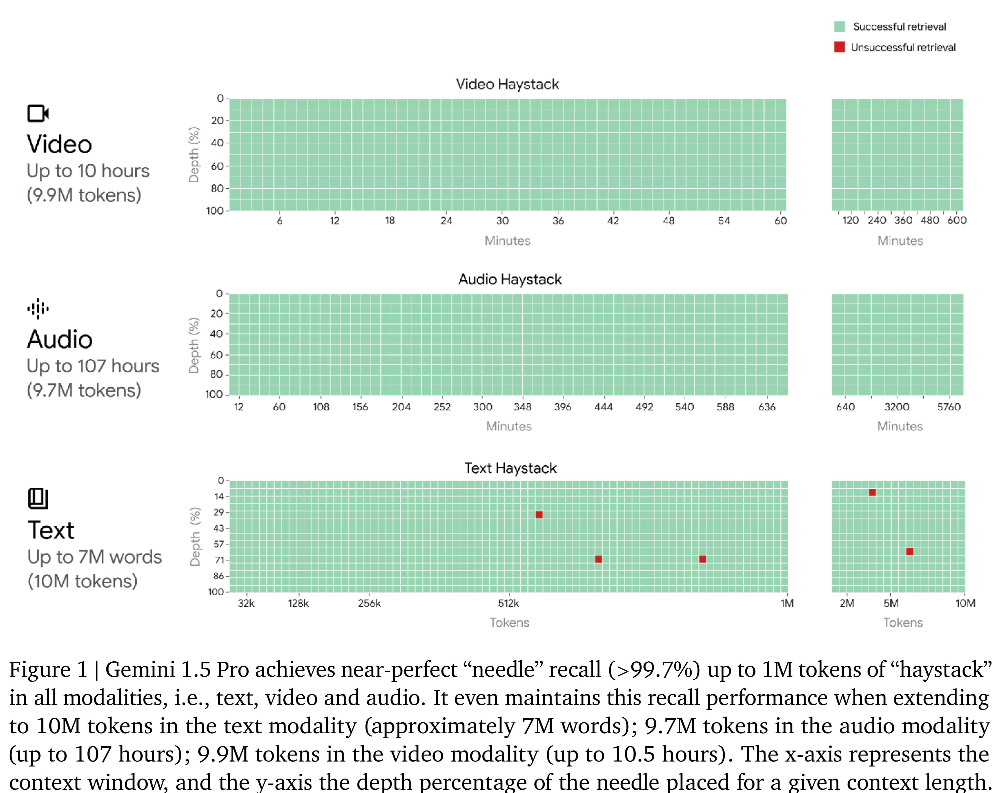
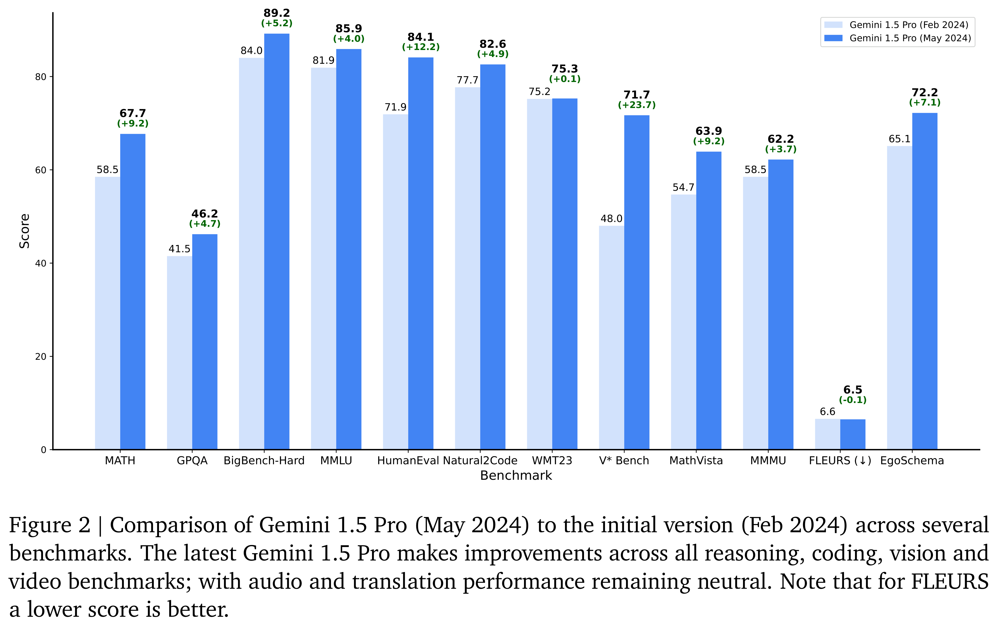

# Gemini 1.5 Technical Report

[Official source](https://storage.googleapis.com/deepmind-media/gemini/gemini_v1_5_report.pdf#page=105)

## 1. Introduction

We present our latest multimodal models from the Gemini line: Gemini 1.5 Pro and Gemini 1.5 Flash. They are members of Gemini 1.5, a new family of highly-capable multimodal models which incorporates our latest innovations in sparse and dense scaling as well as major advances in training, distillation and serving infrastructure that allow it to push the boundary of efficiency, reasoning, planning, multi-linguality, function calling and long-context performance. Gemini 1.5 models are built to handle extremely long contexts; they have the ability to recall and reason over fine-grained information from up to at least 10M tokens. This scale is unprecedented among contemporary large language models (LLMs), and enables the processing of long-form mixed-modality inputs including entire collections of documents, multiple hours of video, and almost five days long of audio.

The Gemini 1.5 Pro presented in this report is an update over the previous Gemini 1.5 Pro February version and it outperforms it predecessor on most capabilities and benchmarks. All in all, the Gemini 1.5 series represents a generational leap in model performance and training efficiency. Gemini 1.5 Pro surpasses Gemini 1.0 Pro and 1.0 Ultra on a wide array of benchmarks while requiring significantly less compute to train. Similarly, Gemini 1.5 Flash performs uniformly better compared to 1.0 Pro and even performs at a similar level to 1.0 Ultra on several benchmarks.

The ability to model data of increasingly longer contexts has tracked the development of more general and capable language models, from the now toy 2-gram language model proposed by Shannon (1948), to the modern n-gram models of the 1990s & 2000s typically constrained to 5 tokens of context (Brants et al., 2007; Chen and Goodman, 1999; Jelinek, 1998; Kneser and Ney, 1995), to recurrent neural networks language models from the 2010s which could effectively condition on hundreds of tokens (Jozefowicz et al., 2016; Mikolov et al., 2010), to the modern Transformer (Vaswani et al., 2017) which can condition on hundreds of thousands of tokens (Anthropic, 2023a). Gemini 1.5 Pro continues this trend by extending language model context lengths by over an order of magnitude. Scaling to millions of tokens, we find a continued improvement in predictive performance (Section 5.2.1.1), near perfect recall (>99%) on synthetic retrieval tasks (Figure 1 and Section 5.2.1.2), and a host of surprising new capabilities like in-context learning from entire long documents and multimodal content (Section 5.2.2).

To measure the effectiveness of our models’ multimodal long-context capabilities, we conduct experiments on both synthetic and real-world tasks. In synthetic “needle-in-a-haystack” tasks inspired by Kamradt (2023) that probe how reliably the model can recall information amidst distractor context, we find that both Gemini 1.5 Pro and Gemini 1.5 Flash achieve near-perfect (>99%) “needle” recall up to multiple millions of tokens of “haystack” in all modalities, i.e., text, video and audio. As part of our experimental setup, we also assessed the performance of Gemini 1.5 Pro when extending the context to 10M tokens across all three modalities. We found that the recall performance was maintained even with this significant increase in context size.

Gemini 1.5 Pro

Relative to 1.5 Pro (Feb) Relative to 1.0 Pro Relative to 1.0 Ultra

Long-Context Text, Video & Audio

Core Capabilities

no change

from 32k up to 10M tokens

from 32k up to 10M tokens

Win-rate: 78.1%

Win-rate: 88.0%

Win-rate: 77.8%

Text

Vision

Audio*

Gemini 1.5 Flash

Relative to 1.0 Pro

Relative to 1.0 Ultra

Long-Context Text, Video & Audio

Core Capabilities

Text

Vision

Audio

from 32k up to 10M tokens

from 32k up to 10M tokens

Win-rate: 82.0%

Win-rate: 46.7%

In more realistic multimodal long-context benchmarks which require retrieval and reasoning over multiple parts of the context (such as answering questions from long documents or long videos), we also see Gemini 1.5 Pro outperforming all competing models across all modalities even when these models are augmented with external retrieval methods. We showcase the in-context learning abilities of both Gemini 1.5 Pro and Gemini 1.5 Flash enabled by very long context: for example, learning to translate a new language from a single set of linguistic documentation. With only instructional materials (a 500-page reference grammar, a dictionary, and ≈ 400 extra parallel sentences) all provided in context, Gemini 1.5 Pro and Gemini 1.5 Flash are capable of learning to translate from English to Kalamang— a Papuan language with fewer than 200 speakers2 and therefore almost no online presence—with quality similar to a person who learned from the same materials. Moreover, we add in 45 minutes of transcribed Kalamang speech recordings to demonstrate that Gemini 1.5, for the first time with an LLM, can leverage mixed-modal documentation to learn speech recognition for a new language in context. We further showcase how long-context capability of Gemini 1.5 models break grounds on long-context automatic speech recognition, long-context video understanding, in-context planning and unstructured multimodal data analytics tasks.

Importantly, this leap in long-context performance does not come at the expense of the core multimodal capabilities of the model.3 Across a extensive battery of evaluations, both Gemini 1.5 Pro and Gemini 1.5 Flash greatly surpass Gemini 1.0 Pro (44/50 for Gemini 1.5 Pro and 41/50 for Gemini 1.5 Flash). These include core capabilities such as Math, Science and Reasoning (+49.6% and +30.8%, respectively, Sec. 6.1.1), Multilinguality (+21.4% and +16.7%, Sec. 6.1.4), Video Understanding (+18.7% and +7.5%, Sec. 6.2.4), Natural Image Understanding (+21.7% and +18.9%, Sec. 6.2.3), Chart and Document Understanding (+63.9% and +35.9%, Sec. 6.2.2), Multimodal Reasoning (+31.5% and +15.6%, Sec. 6.2.1), Code (+21.5% and +10.3%, Sec. 6.1.3), and more (see Table 10 and Table 2 for full breakdowns). These evaluations additionally evaluate on a series of “agentic” tasks including Function Calling (+72.8% and +54.6%, Sec. 6.1.5), planning (Sec. 5.2.2.7) and in-the-wild long-tail real world use cases such as improving job productivity for professionals (Sec. 6.1.7). These advances are particularly striking when benchmarking against Gemini 1.0 Ultra, a state-of-the-art model across many capabilities. Despite using significantly less training compute and being more efficient to serve, Gemini 1.5 Pro performs better on more than half of the overall benchmarks (35/45), and the majority of vision (18/21) and text (16/19) benchmarks. For Gemini 1.5 Flash, which substantially more efficient to serve and faster at inference time, we find it to be be better than Ultra 1.0 on the majority of vision benchmarks (13/21) and almost half the text benchmarks (8/18).

In the following sections, we provide an overview of the model architecture and present the results of large-scale quantitative evaluations comparing Gemini 1.5 Pro and 1.5 Flash to other LLMs. We present detailed evaluations for the models’ long context capabilities followed by evaluations of their core capabilities, similar to the Gemini 1.0 Technical Report (Gemini-Team et al., 2023), covering well-studied benchmarks across text, code, image, video and audio. Finally, we discuss our approach to responsible deployment, including our process for impact assessment developing model policies, evaluations, and mitigations of harm before deployment decisions.4

Figure 1 | Gemini 1.5 Pro achieves near-perfect “needle” recall (>99.7%) up to 1M tokens of “haystack” in all modalities, i.e., text, video and audio. It even maintains this recall performance when extending to 10M tokens in the text modality (approximately 7M words); 9.7M tokens in the audio modality (up to 107 hours); 9.9M tokens in the video modality (up to 10.5 hours). The x-axis represents the

p. 2

Figure 2 | Comparison of Gemini 1.5 Pro (May 2024) to the initial version (Feb 2024) across several benchmarks. The latest Gemini 1.5 Pro makes improvements across all reasoning, coding, vision and video benchmarks; with audio and translation performance remaining neutral. Note that for FLEURS a lower score is better.

p. 5
