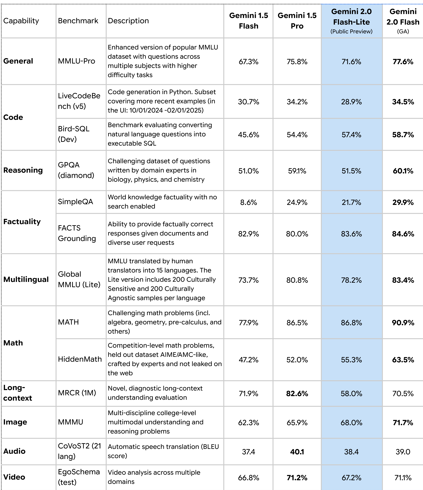

# Gemini 2.0 Flash-Lite Model Card

[Official source](https://storage.googleapis.com/deepmind-media/Model-Cards/Gemini-2-0-Flash-Lite-Model-Card.pdf)

## Description:

Gemini 2.0 Flash-Lite is a member of the Gemini 2.0 series of models, a suite of highly-capable, natively multimodal models designed to power a new era of agentic systems. Gemini 2.0 Flash-Lite is Google’s most cost-efficient model, striking a balance between efficiency and quality targeting low-cost workflows.

p. 4
