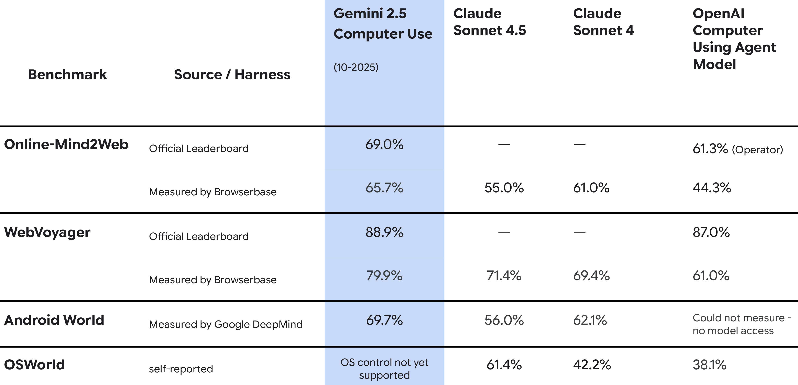

# Gemini 2.5 Computer Use Model Card

[Official source](https://storage.googleapis.com/deepmind-media/Model-Cards/Gemini-2-5-Computer-Use-Model-Card.pdf)

## Description:

The Gemini 2.5 Computer Use model is based on the Gemini 2.5 Pro (06-2025) model, including architecture, training data, implementation and sustainability, with post-training to improve UI control capabilities. The model has primarily been optimized for understanding and interacting with web browsers. It has not yet been optimized for OS-level control or mobile control, although it demonstrates promise for mobile UI control tasks.

The model’s core capabilities are exposed through a new computer use tool that enables applications to interact with and automate tasks in the browser. Using screenshots, the model can "see" a computer screen, and "act" by generating specific UI actions like mouse clicks and keyboard inputs.

●

p. 3
