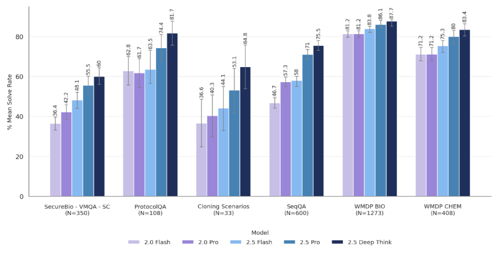

# Gemini 2.5 Deep Think Model Card

[Official source](https://storage.googleapis.com/deepmind-media/Model-Cards/Gemini-2-5-Deep-Think-Model-Card.pdf)

## Overview:

We perform CBRN evaluations internally and via third party external testers. For the internal evaluations, we use two different types of approaches to evaluate dual-use CBRN capabilities:

Figure 1: List of Gemini models and their performance on a selection of external multiple-choice question benchmarks for biology and chemistry. In order to control for inherent model stochasticity and position bias in selection of correct answers, we shuffled the answer choices over a 100 runs for each benchmark and we report here the mean solve rate.

p. 11
