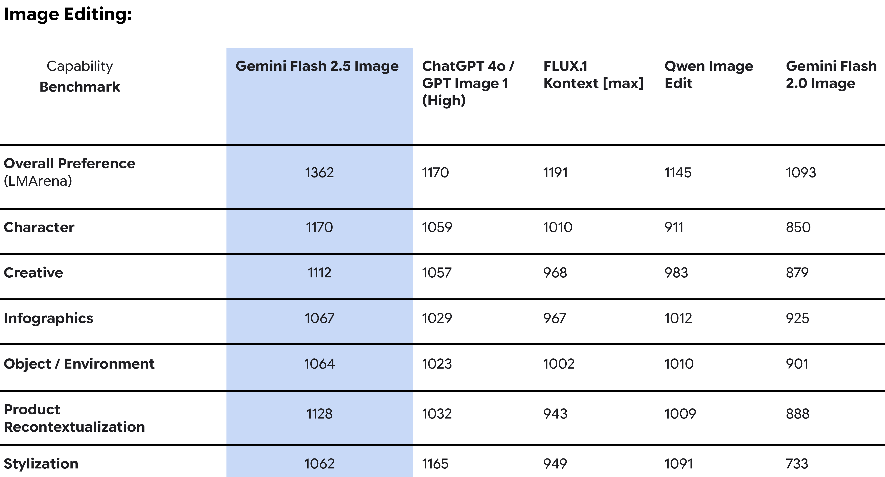

# Gemini 2.5 Flash and Gemini 2.5 Flash Image Model Card

[Official source](https://storage.googleapis.com/deepmind-media/Model-Cards/Gemini-2-5-Flash-Model-Card.pdf)

## Description:

Gemini 2.5 Flash is the next iteration in the Gemini 2.0 series of models, a suite of highly-capable, natively multimodal, reasoning models. Gemini 2.5 Flash is Google’s first fully hybrid reasoning model, giving developers the ability to turn a model’s thinking on or off. The model also allows developers to set thinking budgets to find the right tradeoff between quality, cost, and latency. This model card describes the native capabilities (e.g. image and audio) as additional outputs of Gemini 2.5 Flash; information specific to these modalities is specified in line (i.e. ‘Gemini 2.5 Flash Image’, 'Gemini 2.5 Flash Audio'). Deployment status continues to be “general availability.”

p. 7
