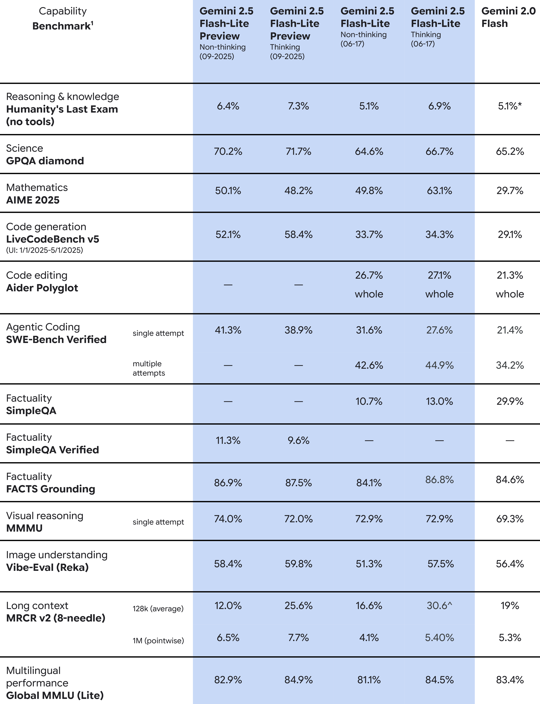

# Gemini 2.5 Flash-Lite Model Card

[Official source](https://storage.googleapis.com/deepmind-media/Model-Cards/Gemini-2-5-Flash-Lite-Model-Card.pdf)

## Description:

Gemini 2.5 Flash-Lite is an addition to our hybrid reasoning model family, giving developers the ability to turn a model's thinking on or off. The model is cost-efficient and fast, optimized for high-volume, latency-sensitive tasks like translation and classification. This model offers improved performance compared to 2.0 Flash-Lite, with strong results in coding, math, science, and reasoning benchmarks.

As of September 25, 2025, there is a preview version offered alongside 2.5 Flash-Lite, specified as “Gemini 2.5 Flash-Lite Preview (09-2025)”, which is designed to address developer feedback, with key quality improvements, including better instruction following, reduced verbosity, and stronger multimodal and translation capabilities.

p. 5
