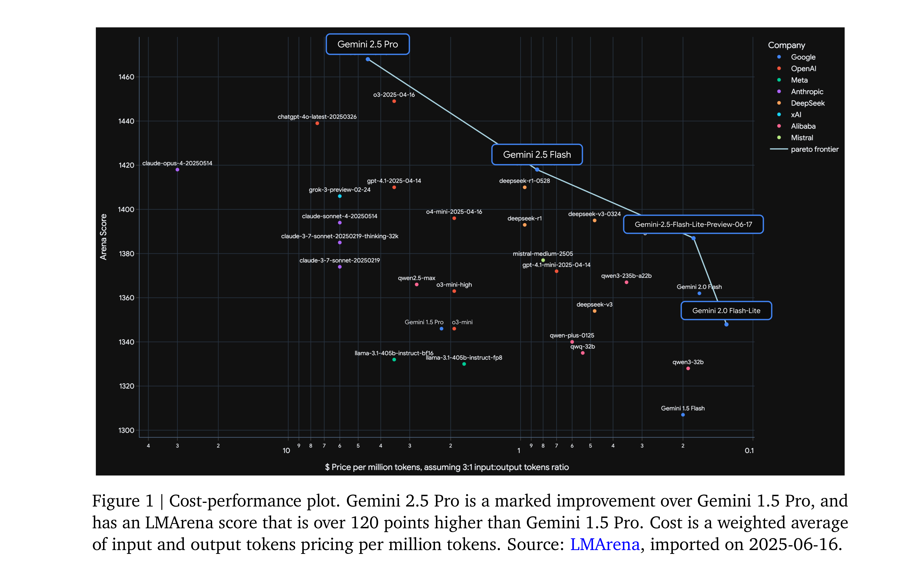
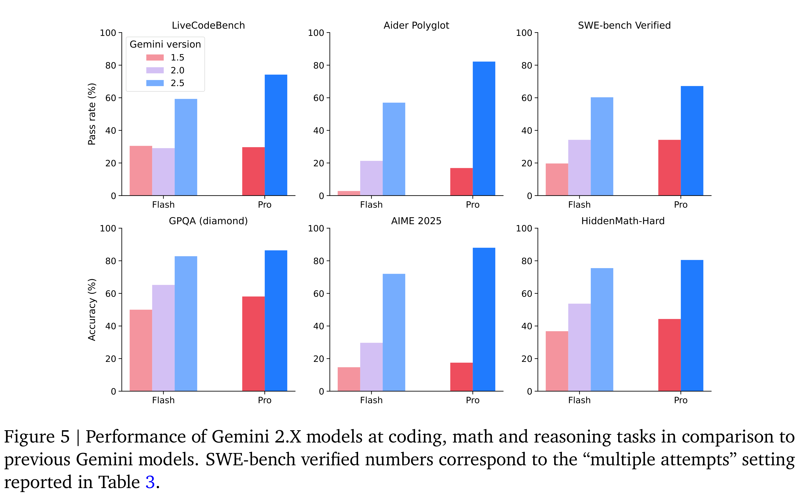

# Gemini 2.5: Pushing the Frontier with Advanced Reasoning, Multimodality, Long Context, and Next Generation Agentic Capabilities

[Official source](https://arxiv.org/abs/2507.06261)

## 1. Introduction

We present our latest family of natively multimodal models with advanced reasoning through thinking, long context and tool-use capabilities: Gemini 2.5 Pro and 2.5 Flash and our earlier Gemini 2.0 Flash and Gemini 2.0 Flash-Lite models. Together these form a new family of highly-capable models representing our next generation of AI models, designed to power a new era of agentic systems. Building upon the foundation of the Gemini 1.5 series (Gemini Team, 2024), this Gemini 2.X generation brings us closer to the vision of a universal AI assistant (Hassabis, 2025).

The Gemini 2.X series are all built to be natively multimodal, supporting long context inputs of >1 million tokens and have native tool use support. This allows them to comprehend vast datasets and handle complex problems from different information sources, including text, audio, images, video and even entire code repositories. These extensive capabilities can also be combined to build complex agentic systems, as happened in the case of Gemini Plays Pokémon1 (Zhang, 2025). Different models in the series have different strengths and capabilities: (1) Gemini 2.5 Pro is our most intelligent thinking model, exhibiting strong reasoning and code capabilities. It excels at producing interactive web applications, is capable of codebase-level understanding and also exhibits emergent multimodal coding abilities. (2) Gemini 2.5 Flash is our hybrid reasoning model with a controllable thinking budget, and is useful for most complex tasks while also controlling the tradeoff between quality, cost, and latency. (3) Gemini 2.0 Flash is our fast and cost-efficient non-thinking model for everyday tasks and (4) Gemini 2.0 Flash-Lite is our fastest and most cost-efficient model, built for at-scale usage. A full comparison of the models in the Gemini 2.X model family is provided in Table 1. Taken together, the Gemini 2.X family of models cover the whole Pareto frontier of model capability vs cost, shifting it forward across a large variety of core capabilities, applications and use-cases, see Figure 1.

The Gemini 2.5 family of models maintain robust safety metrics while improving dramatically on

helpfulness and general tone compared to their 2.0 and 1.5 counterparts. In practice, this means that the 2.5 models are substantially better at providing safe responses without interfering with important use cases or lecturing end users. We also evaluated Gemini 2.5 Pro’s Critical Capabilities, including CBRN, cybersecurity, machine learning R&D, and deceptive alignment. While Gemini 2.5 Pro showed a significant increase in some capabilities compared to previous Gemini models, it did not reach any of the Critical Capability Levels in any area.

Our report is structured as follows: we begin by briefly describing advances we have made in model architecture, training and serving since the release of the Gemini 1.5 model. We then showcase the performance of the Gemini 2.5 models, including qualitative demonstrations of its abilities. We conclude by discussing the safety evaluations and implications of this model series.

Figure 1 | Cost-performance plot. Gemini 2.5 Pro is a marked improvement over Gemini 1.5 Pro, and
has an LMArena score that is over 120 points higher than Gemini 1.5 Pro. Cost is a weighted average
of input and output tokens pricing per million tokens. Source: LMArena, imported on 2025-06-16.

p. 3

Figure 5 | Performance of Gemini 2.X models at coding, math and reasoning tasks in comparison to
previous Gemini models. SWE-bench verified numbers correspond to the “multiple attempts” setting
reported in Table 3.

p. 11
