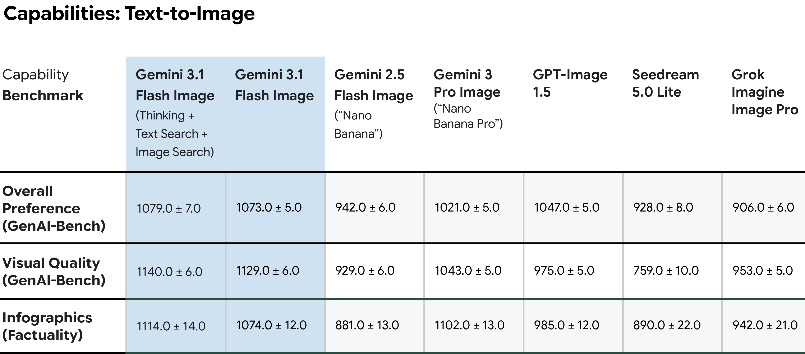

# Gemini 3.1 Flash Image Model Card

[Official source](https://deepmind.google/models/model-cards/gemini-3-1-flash-image/)

## Description:

Gemini 3.1 Flash Image is a member of the Gemini series of models, a suite of highly-capable, natively multimodal reasoning models. Gemini 3.1 Flash Image can comprehend input from different information sources, including text, images, audio and video. Image and text output is generated in the response.

p. 5
