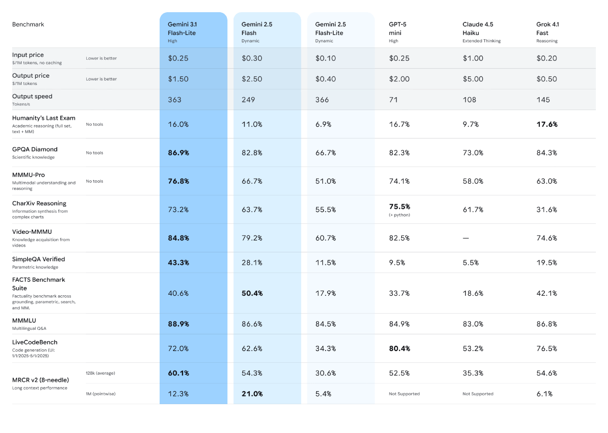

# Gemini 3.1 Flash-Lite Model Card

[Official source](https://deepmind.google/models/model-cards/gemini-3-1-flash-lite/)

## Description:

Gemini 3.1 Flash-Lite is an addition to the Gemini 3 series of highly-capable, natively multimodal, reasoning models. The model is cost-efficient and fast, optimized for high-volume, latency-sensitive tasks like translation and classification.

p. 4
