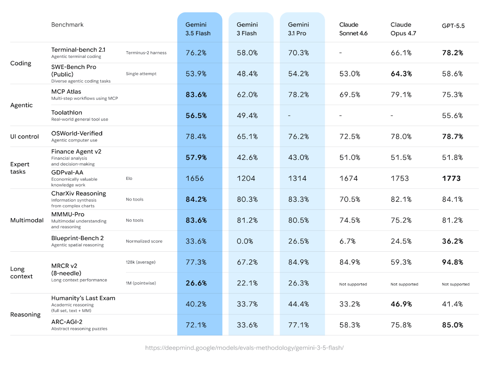

# Gemini 3.5 Flash Model Card

[Official source](https://deepmind.google/models/model-cards/gemini-3-5-flash/)

## Description:

Gemini 3.5 Flash is the next iteration in the Gemini 3 series of highly-capable, natively multimodal, reasoning models. Gemini 3.5 Flash is based on the Gemini 3 Flash reasoning foundation with thinking levels to control the mix of quality, cost and latency.

p. 4
