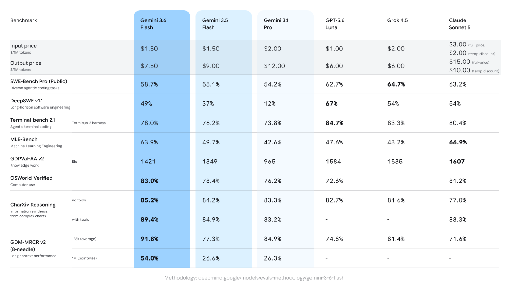

# Gemini 3.6 Flash Model Card

[Official source](https://deepmind.google/models/model-cards/gemini-3-6-flash/)

## Description

Gemini 3.6 Flash is an addition to the Gemini 3 series of highly-capable, natively multimodal, reasoning models. Gemini 3.6 Flash is our workhorse model that delivers better coding, knowledge work, and multimodal performance, while providing better token-efficiency than Gemini 3.5 Flash.

p. 4
