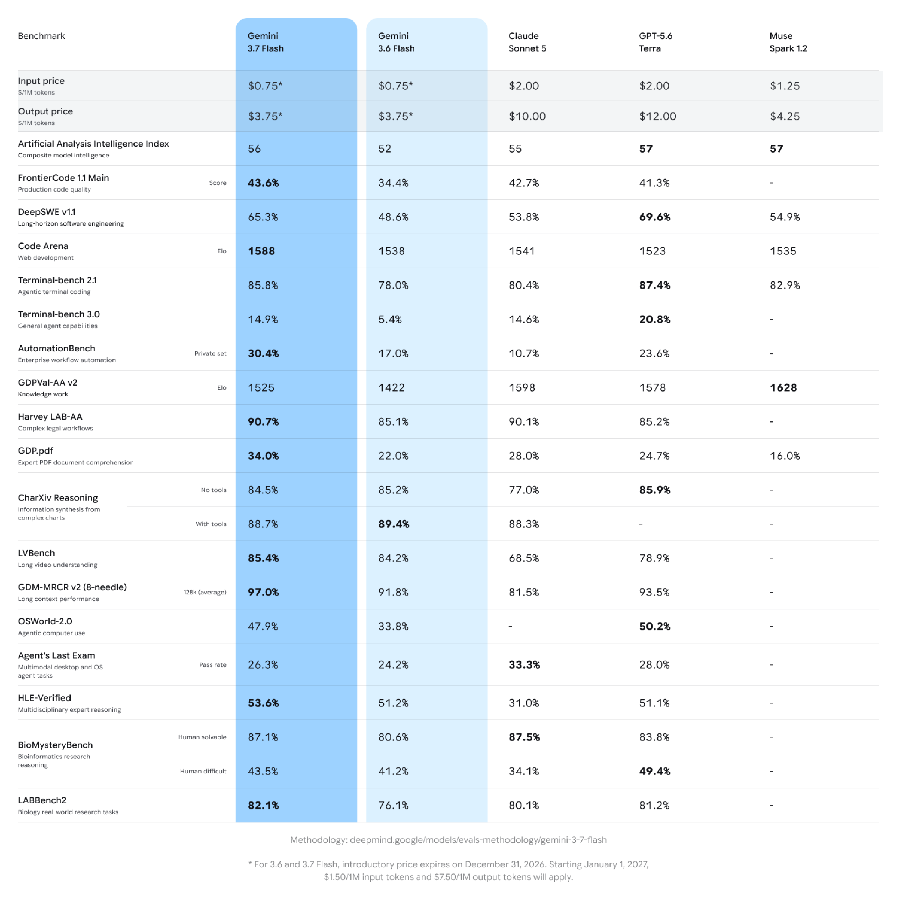

# Gemini 3.7 Flash Model Card

[Official source](https://deepmind.google/models/model-cards/gemini-3-7-flash/)

## Description

Gemini 3.7 Flash is the next iteration in the Gemini 3 model family, featuring algorithmic improvements to its core reasoning foundation and support for agentic video understanding. It supports customizable thinking configurations to control the mix of quality, cost and latency.

## Training and Development Evaluation Results

Results for some of the internal safety evaluations conducted during the development phase are listed below. The evaluation results are for automated evaluations and not human evaluation or red teaming.

p. 6

p. 5
