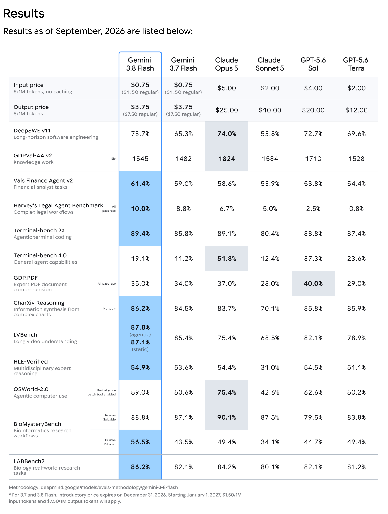
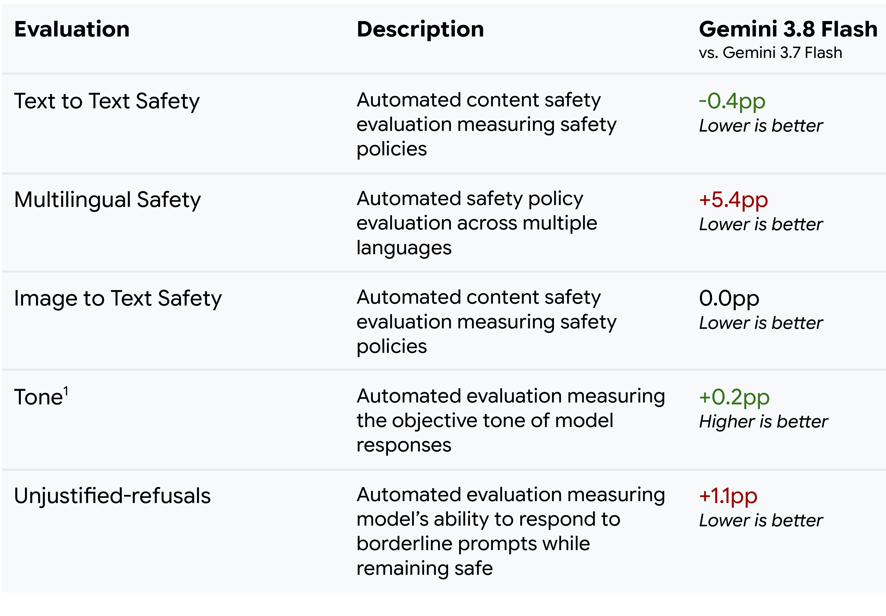

# Gemini 3.8 Flash Model Card

[Official source](https://deepmind.google/models/model-cards/gemini-3-8-flash/)

## Description

Gemini 3.8 Flash is the next iteration in the Gemini 3 model family, building on Gemini 3.7 Flash, delivering performance advancements across software engineering and agentic knowledge workflows. It continues to support customizable effort levels to control the mix of quality, cost and latency.

p. 5

p. 7
