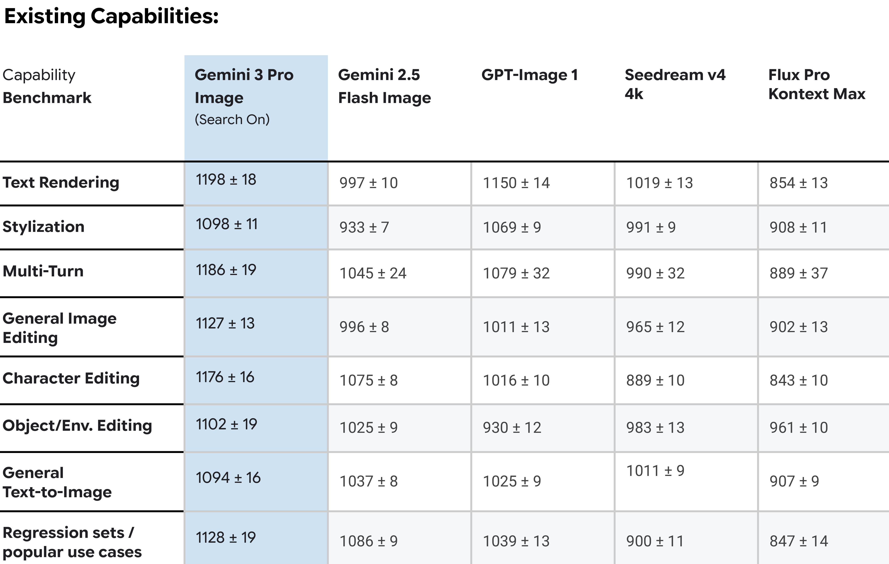

# Gemini 3 Pro Image Model Card

[Official source](https://deepmind.google/models/model-cards/gemini-3-pro-image/)

## Description:

Gemini 3 Pro Image is the next generation in the Gemini series of models, a suite of highly-capable, natively multimodal, reasoning models. Gemini 3 Pro Image is now Google’s most advanced model for image generation and can comprehend vast datasets, challenging problems from different information sources, including text and images.

p. 4
