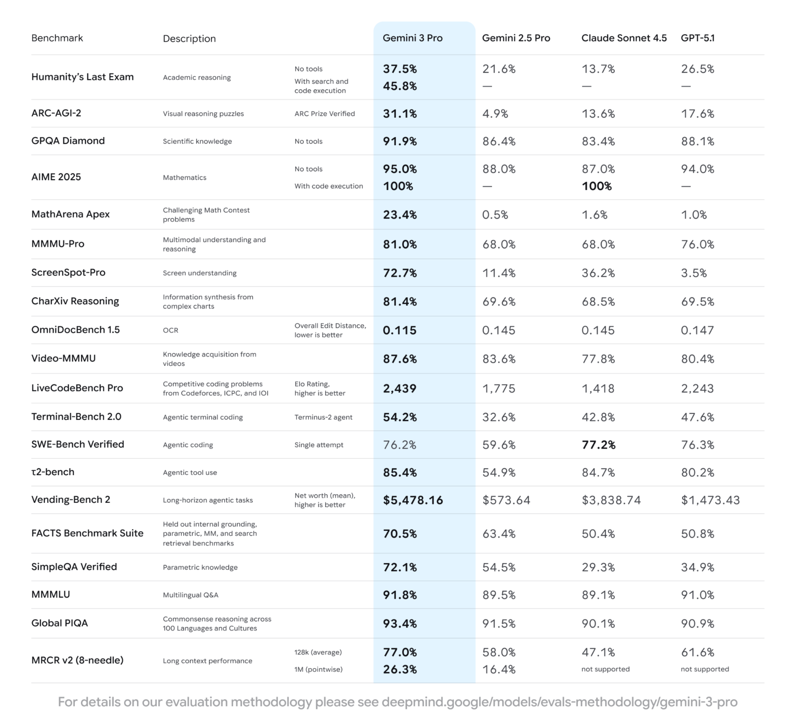

# Gemini 3 Pro Model Card

[Official source](https://deepmind.google/models/model-cards/gemini-3-pro/)

## Description:

Gemini 3 Pro is the next generation in the Gemini series, a suite of highly-capable, natively multimodal, reasoning models. Gemini 3 Pro is now Google’s most advanced model for complex tasks, and can comprehend vast datasets and challenging problems from different information sources, including text, audio, images, video, and entire code repositories. Gemini 3 Pro now features Deep Think mode, an optional setting designed to enhance complex problem-solving performance at time of inference.

p. 5
