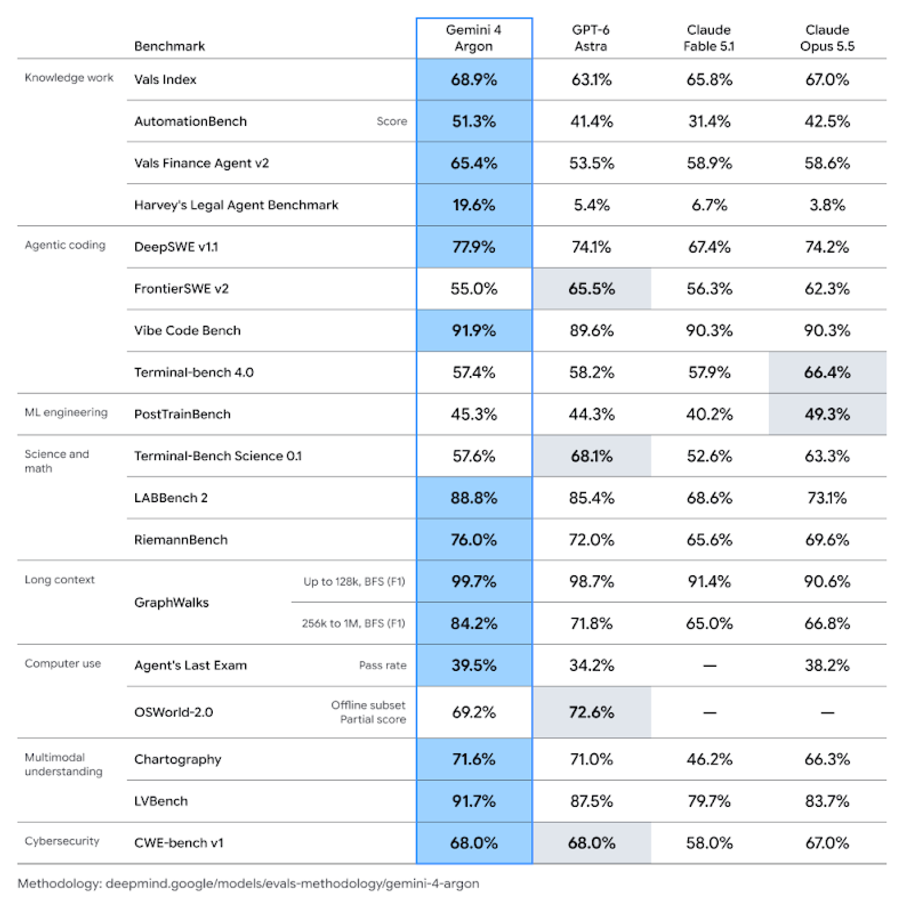

# Gemini 4 Argon Model Card

[Official source](https://deepmind.google/models/model-cards/gemini-4-argon/)

## Description

Gemini 4 is the next generation in the Gemini series, a suite of highly-capable, natively multimodal, reasoning models. Gemini 4 Argon delivers frontier performance to help in complex workflows across real-world software engineering, enterprise knowledge work like legal and finance, and cybersecurity defense.

## Architecture

Gemini 4 Argon is a large scale sparse mixture-of-experts (MoE) (Clark et al., 2022; Du et al., 2021; Fedus et al., 2021; Jiang et al., 2024, Lepikhin et al., 2020; Riquelme et al., 2021; Roller et al., 2021; Shazeer et al., 2017) transformer-based model (Vaswani et al., 2017) with native multimodal support for text, vision, and audio inputs.

p. 3

p. 6
