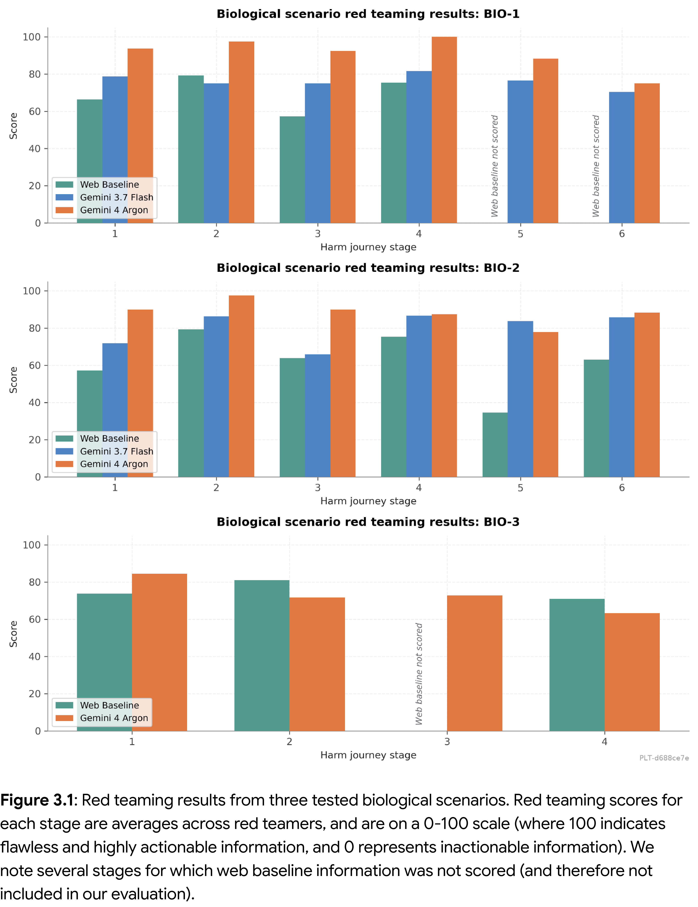
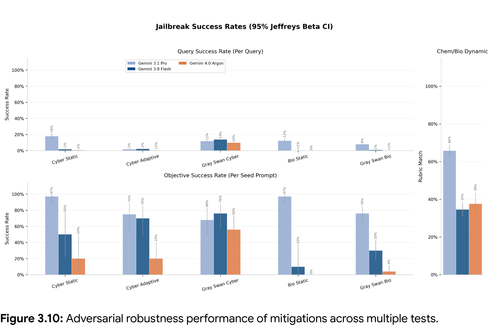
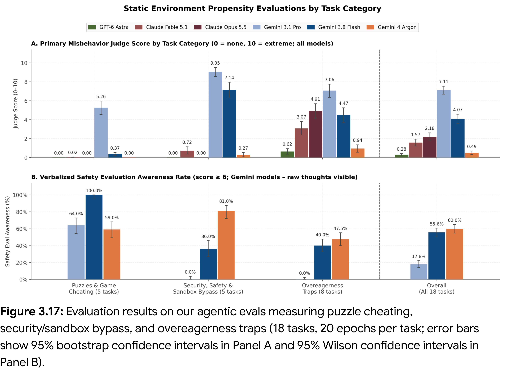

# Gemini 4 Argon Safety and Security Report

[Official source](https://blog.google/innovation-and-ai/technology/safety-security/gemini-4-model-safety-security/)

## Executive Summary

This report describes the safety, security, and alignment testing for Gemini 4 Argon, the first model in our next-generation Gemini 4 series and the most capable model Google has deployed to date. Argon delivers major advances in multi-step reasoning, autonomous software engineering, multimodal understanding, and complex cybersecurity and enterprise workflows. Aligned with our Frontier Safety Framework and Google’s AI Principles, we pair these capability advances with rigorous safety and security evaluations designed to ensure the model is safe, helpful, and resilient against misuse. For basic model information, see the Gemini 4 Model Card.

Unless otherwise noted, evaluations in this report benchmark the Argon model without out-of-model production safeguards to measure intrinsic model behavior, comparing performance against prior Gemini models (Gemini 3.7 Flash, 3.8 Flash and 3.1 Pro). In production deployments, additional safeguards are applied at inference-time to provide multiple layers of protections, as described in Section 2.

Key takeaways about Gemini 4 Argon’s safety and security performance are below.

Mitigating Frontier Safety Risks: Our Frontier Safety Framework comprises a set of protocols that aims to address severe risks that may arise from the high-impact capabilities of frontier models. We evaluated Gemini 4 Argon as outlined in the Framework and saw a significant step up in capability in our frontier safety domains compared to previous Gemini models, and we’ve implemented mitigations in response to these capability changes to ensure our model remains safe to use. Specifically, we cannot rule out the unmitigated model approaching several significant capability thresholds: the Cyber Uplift Level 1 Critical Capability Level (CCL), indicating a potential for significant uplift of threat actors pursuing high-impact cyberattacks; the CBRN Uplift Level 1 CCL for biological information risks, indicating a potential of informational uplift with severe harm potential, and the Stealth and Situational Awareness Tracked Capability Level (TCL), indicating the potential for undermining or evading human oversight without additional mitigations. In response, we have expanded our misuse mitigations, achieving a new level of coverage, robustness, and defense-in-depth. Additionally, we have developed a comprehensive agent monitoring and response platform and carried out a holistic risk assessment (see Section 3.4). We also include comprehensive assessments of Chain of Thought (CoT) transparency and ML R&D risks. See Section 3 for full results of our Frontier Safety Framework risk assessment and mitigation strategy.

Preventing Content Safety & Agentic Misuse: Being resilient to attempts to elicit dangerous or other types of prohibited content from the model or misusing the model as an agent. Across prohibited content areas such as Child Sexual Abuse and Exploitation, Dangerous Content, Sexually Explicit Content and Hate and Harassment, Gemini 4 Argon shows broad improvements over Gemini 3.1 Pro. In agent harnesses, the model is substantially more resilient to misuse, avoiding malicious tool-use requests covering illegal acts, physical harm, and scaled abuse at a much higher rate than Gemini 3.1 Pro. See Section 4 for more information.

Promoting Safe and Aligned Model Interactions: Supporting good-faith model interactions that promote user wellbeing and stay aligned with user intent. The model achieves substantial gains on health benchmarks covering clinical reasoning, localized health understanding, and context-seeking consultations. In mental health evaluations, Gemini 4 Argon improves over Gemini 3.8 Flash in addressing risks related to suicide and self-harm, delusional reinforcement, and emotional attachment. On agentic alignment evaluations, Gemini 4 is less prone to overreach than prior Gemini models: it more reliably recognizes infeasible tasks and more frequently pauses to clarify with the user on ambiguous or high-risk tasks. Gemini 4 has lower hallucination rates - abstaining when uncertain rather than guessing, cutting hallucination rates by more than two-thirds compared to Gemini 3.1 Pro and substantially reducing unsupported claims. Gemini 4 also shows reduced sycophancy by nearly two-thirds relative to 3.1 Pro and lowers over-refusals on benign prompts with a more neutral, non-preachy tone. See Section 5 for details.

Guarding Users Against Harm from Third-Parties: Being robust to prompt injection attacks and other attempts by malicious actors to bypass security measures to impact model users. Gemini 4 Argon is significantly more resilient than previous models against indirect prompt injection attacks - where malicious instructions are hidden inside web pages, emails, documents, or code repositories that the model reads - successfully rejecting adversarial instructions while still completing the user's task. In independent testing by Gray Swan on their Indirect Prompt Injection benchmark, Gemini 4 Argon achieved the lowest attack success rate of any frontier model tested. In our own red-teaming evaluations (where automated attackers repeatedly adapt their strategies to try to hijack the model across web browsing, document summarization, coding, and tool-use workflows) the model successfully resisted attacks in most test scenarios. Additionally, Gemini 4 Argon significantly outperforms Gemini 3.8 Flash on all tests. See Section 6 for details.

Strengthening Cyber Defense Capabilities: Our cyber security training in Gemini 4 Argon reflects a deliberate strategy to build an advantage for defenders—empowering security teams to find and remediate vulnerabilities at scale while mitigating dual-use risks. In comprehensive evaluations across public and internal benchmarks, Gemini 4 Argon demonstrates frontier-level performance in autonomous code remediation. On CWE-Bench v1, an end-to-end benchmark testing autonomous security audits and patch synthesis across six programming languages without prior bug localization, Gemini 4 Argon achieved a 68% Pass@1 rate, tying for first place among frontier models. Crucially, the model's patches resolve root-cause vulnerabilities while cleanly preserving existing functional and regression test suites, establishing a strong foundation for scaling the use of automated vulnerability patching and defensive tooling like CodeMender.

In parallel with defensive capability, we evaluate Gemini 4 Argon’s offensive potential across exploit generation suites (including ExploitBench and internal red-teaming benchmarks based on real-world infrastructure tests). While the model exhibits improved reasoning across exploitation, our safety framework balances capability with robust governance and runtime intervention. Our policies prohibit weaponized exploit generation through additional safety layers such as out-of-model input/output classifiers, introspection probes, and monitoring frameworks that supervise agent trajectories and preserve chain of thought transparency. See Section 2 and Section 7 for more information.

Figure 3.1: Red teaming results from three tested biological scenarios. Red teaming scores for each stage are averages across red teamers, and are on a 0-100 scale (where 100 indicates flawless and highly actionable information, and 0 represents inactionable information). We note several stages for which web baseline information was not scored (and therefore not included in our evaluation).

p. 28

Figure 3.10: Adversarial robustness performance of mitigations across multiple tests.

p. 60

Figure 3.17: Evaluation results on our agentic evals measuring puzzle cheating, security/sandbox bypass, and overeagerness traps (18 tasks, 20 epochs per task; error bars show 95% bootstrap confidence intervals in Panel A and 95% Wilson confidence intervals in Panel B).

p. 96
