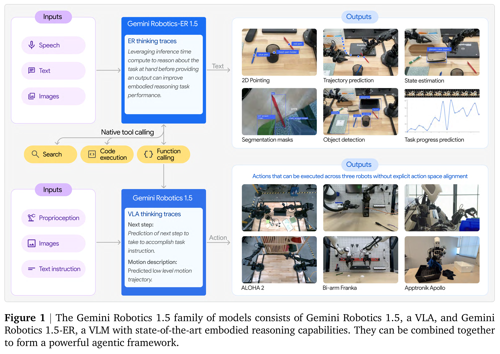

# Gemini Robotics 1.5 Technical Report

[Official source](https://storage.googleapis.com/deepmind-media/gemini-robotics/Gemini-Robotics-1-5-Tech-Report.pdf#page=30)

General-purpose robots need a deep understanding of the physical world, advanced reasoning, and general and dexterous control. This report introduces the latest generation of the Gemini Robotics model family: Gemini Robotics 1.5, a multi-embodiment Vision-Language-Action (VLA) model, and Gemini Robotics-ER 1.5, a state-of-the-art Embodied Reasoning (ER) model. We are bringing together three major innovations. First, Gemini Robotics 1.5 features a novel architecture and a Motion Transfer (MT) mechanism, which enables it to learn from heterogeneous, multi-embodiment robot data and makes the VLA more general. Second, Gemini Robotics 1.5 interleaves actions with a multi-level internal reasoning process in natural language. This enables the robot to “think before acting” and notably improves its ability to decompose and execute complex, multi-step tasks, and also makes the robot’s behavior more interpretable to the user. Third, Gemini Robotics-ER 1.5 establishes a new state-of-the-art for embodied reasoning, i.e., for reasoning capabilities that are critical for robots, such as visual and spatial understanding, task planning, and progress estimation. Together, this family of models takes us a step towards an era of physical agents—enabling robots to perceive, think and then act so they can solve complex multi-step tasks.

Figure 1 | The Gemini Robotics 1.5 family of models consists of Gemini Robotics 1.5, a VLA, and Gemini
Robotics 1.5-ER, a VLM with state-of-the-art embodied reasoning capabilities. They can be combined together
to form a powerful agentic framework.

p. 2
