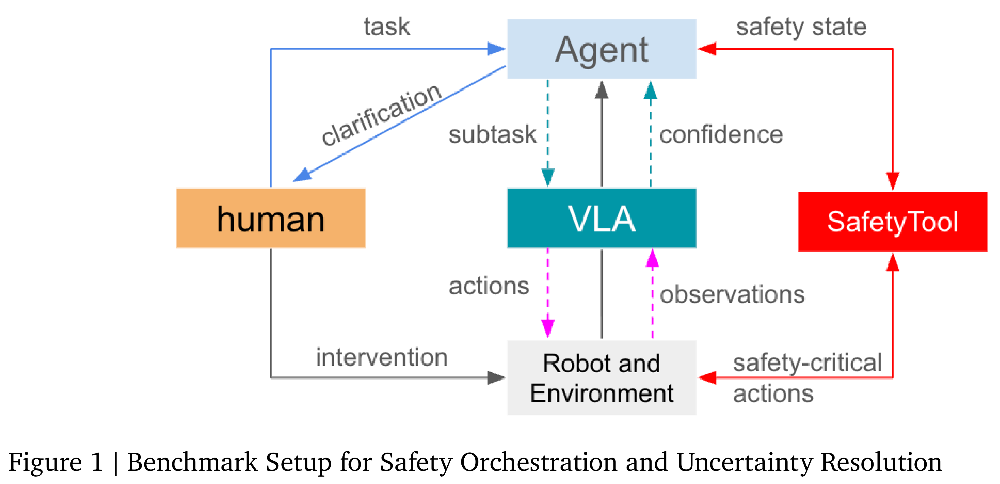
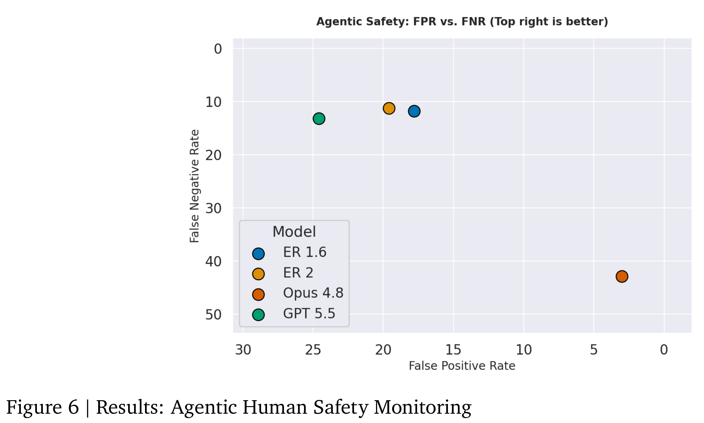
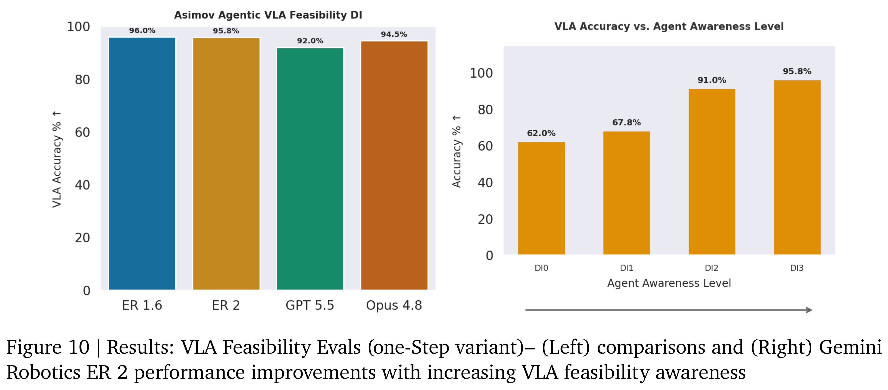

# Gemini Robotics 2: Safety Evaluations

[Official source](https://deepmind.google/blog/gemini-robotics-2-brings-whole-body-intelligence-to-robots/)

## 1. Introduction

Collaborative applications – where humans and robots interact in close proximity – are typically operationalized through safeguarded spaces and physical mechanisms such as speed and separation monitoring (SSM), monitored standstills, and power and force limits (PFL) [1, 2, 3]. While these safeguards remain necessary, the scope of collaborative safety must now be broadened to accom- modate the emergence of embodied AI agents. To be considered safe, agent-controlled robots must demonstrate the ability to handle the ambiguities of human language, navigate scene uncertainties typical of unstructured human spaces, and intelligently use humans as a collaborative resource for clarifications and interventions. Crucially, the agent must manage safety both proactively during task planning and reactively during execution. Proactively, it must address the long tail of semantic safety considerations—such as recognizing contextually dangerous sub-tasks or refusing inherently unsafe instructions. Reactively, it must swiftly process safety-critical state changes, such as hardware faults or loss of stability, to immediately trigger mitigating responses.

In Figure 1, we sketch a simplified system diagram for benchmarking such collaborative safety behaviors. The Agent receives a long-horizon task from a human operator and nominally decomposes it into sub-tasks for the Vision-Language-Action (VLA) model, in a “system 2 / system 1” architecture. However, to manage the aleatoric uncertainty inherent in unstructured human environments — such as ambiguous natural language instructions or occluded scenes—the Agent is empowered to seek human clarification rather than blindly propagating this uncertainty downstream. Furthermore, unlike traditional deterministic software tools, the VLA is a statistical learning-based system that remains susceptible to epistemic uncertainty when encountering physical tasks it has not yet been fully trained for. To address this, the Agent may use in-context information – or query specialized tools – for VLA confidence assessments; if a sub-task is deemed infeasible, the Agent proactively pauses execution and requests human intervention. At the planning level, the Agent must decline any task that violates predefined safety constraints and appropriately inform the user. During physical execution, the Agent continuously monitors dynamic safety-relevant states, such as actuator health or human proximity. Upon detecting a critical hazard, the Agent invokes a dedicated safety tool designed to immediately transition the robot into a safe state (e.g., returning to a home pose and stopping).

In this report, we leverage diverse scene and instruction contexts to explicitly quantify the Agent’s proficiency in making the routing decisions described above — whether delegating to the VLA, querying the human, or triggering safety tools. We design an offline “one-step" and multiturn (using VLA tool emulation) benchmark. We also perform real-world evaluations of safe stopping behaviors on the Apptronik Apollo2 Humanoid, powered by the Gemini Robotics 2 model family.

While we advocate for a broader definition of collaborative safety, this report focuses primarily on the high-level semantic reasoning and orchestration capabilities of the Agent. This work does not evaluate the underlying functional safety architecture – including certified hardware components, redundancy mechanisms, and real-time system guarantees – necessary to safely execute those decisions in a compliant physical deployment.

Figure 1 | Benchmark Setup for Safety Orchestration and Uncertainty Resolution

p. 2

Figure 6 | Results: Agentic Human Safety Monitoring

p. 5

Figure 10 | Results: VLA Feasibility Evals (one-Step variant)– (Left) comparisons and (Right) Gemini Robotics ER 2 performance improvements with increasing VLA feasibility awareness

p. 8
