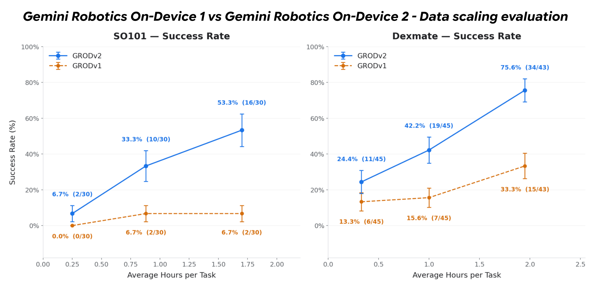

# Gemini Robotics On-Device 2 Model Card

[Official source](https://deepmind.google/models/model-cards/gemini-robotics-on-device-2/)

## Description

Gemini Robotics On-Device is a state-of-the-art Vision-Language-Action (VLA) model based on our on-device Gemma models. It is designed for general-purpose robotic manipulation, operating efficiently on local devices. This model supports a wide range of tasks, scenes, and multiple robot types. It is currently available to a select group of trusted testers.

Gemini Robotics On-Device 1 vs Gemini Robotics On-Device 2 - Data scaling evaluation

p. 4
