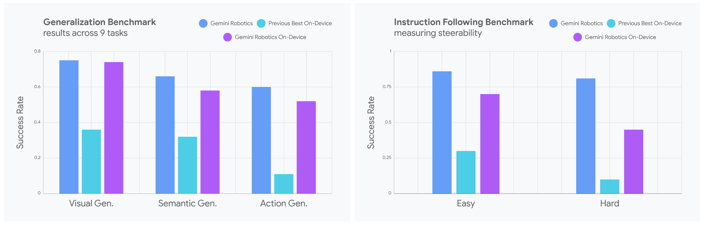

# Gemini Robotics On-Device Model Card

[Official source](https://storage.googleapis.com/deepmind-media/Model-Cards/Gemini-Robotics-On-Device-Model-Card.pdf)

## Description:

Gemini Robotics On-Device is a state-of-the-art Vision-Language-Action (VLA) model based on our on-device Gemma models. It is designed for general-purpose robotic manipulation, operating efficiently on local devices. This model supports a wide range of tasks, scenes, and multiple robot types. It is currently available to a select group of trusted testers.

p. 3
