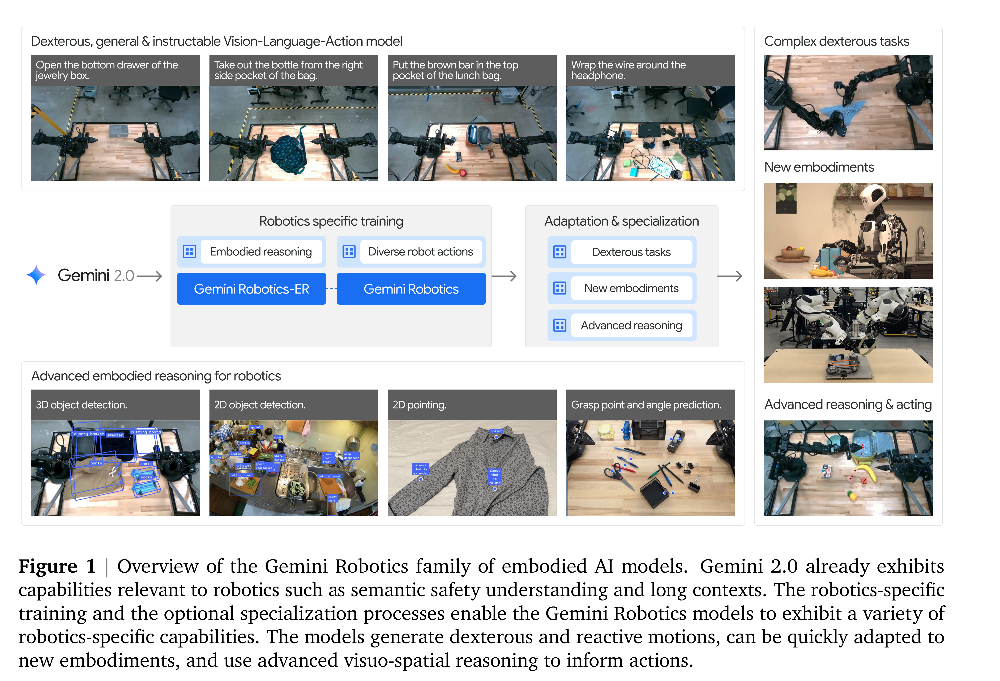

# Gemini Robotics: Bringing AI into the Physical World

[Official source](https://arxiv.org/abs/2503.20020)

## 1. Introduction

The remarkable progress of modern artificial intelligence (AI) models – with pre-training on large- scale datasets – has redefined information processing, demonstrating proficiency and generalization across diverse modalities such as text, images, audio, and video. This has opened a vast landscape of opportunities for interactive and assistive systems within the digital realm, ranging from multimodal chatbots to virtual assistants. However, realizing the potential of general-purpose autonomous AI in the physical world requires a substantial shift from the digital world, where physically grounded AI agents must demonstrate robust human-level embodied reasoning: The set of world knowledge that encompasses the fundamental concepts which are critical for operating and acting in an inherently physically embodied world. While, as humans, we take for granted our embodied reasoning abilities – such as perceiving the 3D structure of environments, interpreting complex inter-object relationships, or understanding intuitive physics – these capabilities form an important basis for any embodied AI agent. Furthermore, an embodied AI agent must also go beyond passively understanding the spatial and physical concepts of the real world; it must also learn to take actions that have direct effects

on their external environment, bridging the gap between passive perception and active physical interaction.

With the recent advancements in robotics hardware, there is exciting potential for creating embodied AI agents that can perform highly dexterous tasks. With this in mind, we ask: What would it take to endow a state-of-the-art digital AI model with the embodied reasoning capabilities needed to interact with our world in a general and dexterous manner?

Our thesis is predicated on harnessing the advanced multimodal understanding and reasoning capabilities inherent in frontier Vision-Language Models (VLMs), such as Gemini 2.0. The generalized comprehension afforded by these foundation models, with their ability to interpret visual inputs and complex text instructions, forms a powerful foundation for building embodied agents. This endeavor hinges on two fundamental components. First, Gemini needs to acquire robust embodied reasoning, gaining the ability to understand the rich geometric and temporal-spatial details of the physical world. Second, we must ground this embodied reasoning in the physical world by enabling Gemini to speak the language of physical actions, understanding contact physics, dynamics, and the intricacies of real-world interactions. Ultimately, these pieces must coalesce to enable fast, safe and dexterous control of robots in the real world.

To this end, we introduce the Gemini Robotics family of embodied AI models, built on top of Gemini 2.0, our most advanced multimodal foundation model. We first validate the performance and generality of the base Gemini 2.0’s innate embodied reasoning capabilities with a new open-source general embodied reasoning benchmark, ERQA. We then introduce two models: The first model is Gemini Robotics-ER, a VLM with strong embodied reasoning capabilities at its core, exhibiting generalization across a wide range of embodied reasoning tasks while also maintaining its core foundation model

capabilities. Gemini Robotics-ER exhibits strong performance on multiple capabilities critical for understanding the physical world, ranging from 3D perception to detailed pointing to robot state estimation and affordance prediction via code. The second model is Gemini Robotics, a state-of-the- art Vision-Language-Action (VLA) model that connects strong embodied reasoning priors to dexterous low-level control of real-world robots to solve challenging manipulation tasks. As a generalist VLA, Gemini Robotics can perform a wide array of diverse and complicated tasks, while also closely following language guidance and generalizing to distribution shifts in instructions, visuals, and motions. To emphasize the flexibility and generality of the Gemini Robotics models, we also introduce an optional specialization stage, which demonstrates how Gemini Robotics can be adapted for extreme dexterity, for advanced reasoning in difficult generalization settings, and for controlling completely new robot embodiments. Finally, we discuss the safety implications of training large robotics models such as the Gemini Robotics models, and provide guidelines for how to study such challenges in the context of VLAs. Specifically, this report highlights:

Figure 1 | Overview of the Gemini Robotics family of embodied AI models. Gemini 2.0 already exhibits
capabilities relevant to robotics such as semantic safety understanding and long contexts. The robotics-specific
training and the optional specialization processes enable the Gemini Robotics models to exhibit a variety of
robotics-specific capabilities. The models generate dexterous and reactive motions, can be quickly adapted to
new embodiments, and use advanced visuo-spatial reasoning to inform actions.

p. 2
